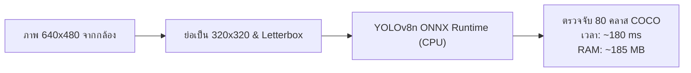
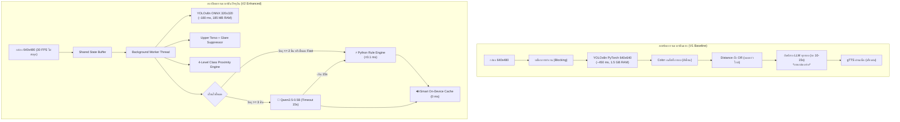

# เอกสารวิศวกรรม: การคัดเลือกโมเดล การเปรียบเทียบกับระบบเวอร์ชันแรก และการทดสอบวัดประสิทธิภาพ (Model Selection, Baseline Comparison & Benchmark Analysis)

**โครงการ:** ระบบผู้ช่วยบรรยายสภาพแวดล้อมและค้นหาสิ่งของสำหรับผู้พิการทางสายตาด้วย Edge AI และ Local LLM บน Raspberry Pi 4 (VisionMate)  
**อุปกรณ์ทดสอบ:** Raspberry Pi 4 Model B Rev 1.5 (RAM 8 GB, CPU Broadcom BCM2711 4-Core Cortex-A72 @ 1.8 GHz)  
**ระบบปฏิบัติการ:** Debian GNU/Linux 13 (trixie) aarch64  

---

## สารบัญ
1. [ทำไมถึงเลือกโมเดลนี้ (Model Selection Rationale)](#1-ทำไมถึงเลือกโมเดลนี้-model-selection-rationale)
   - [1.1 โมเดลตรวจจับวัตถุ: ทำไมต้อง YOLOv8n ONNX (320×320)](#11-โมเดลตรวจจับวัตถุ-ทำไมต้อง-yolov8n-onnx-320320)
   - [1.2 โมเดลภาษา: ทำไมต้อง Qwen2.5-0.5B via Ollama](#12-โมเดลภาษา-ทำไมต้อง-qwen25-05b-via-ollama)
   - [1.3 สถาปัตยกรรมสร้างประโยค: ทำไมต้อง Dual-Path Hybrid Architecture](#13-สถาปัตยกรรมสร้างประโยค-ทำไมต้อง-dual-path-hybrid-architecture)
   - [1.4 ระบบเสียงสังเคราะห์: ทำไมต้อง Smart On-Device Clear Thai TTS](#14-ระบบเสียงสังเคราะห์-ทำไมต้อง-smart-on-device-clear-thai-tts)
2. [เปรียบเทียบกับระบบเวอร์ชันแรก (Comparison with System Version 1 / Baseline)](#2-เปรียบเทียบกับระบบเวอร์ชันแรก-comparison-with-system-version-1--baseline)
   - [2.1 ตารางเปรียบเทียบสถาปัตยกรรมและคุณสมบัติ (Side-by-Side Matrix)](#21-ตารางเปรียบเทียบสถาปัตยกรรมและคุณสมบัติ-side-by-side-matrix)
   - [2.2 การเปลี่ยนแปลงเชิงลึกแต่ละองค์ประกอบ](#22-การเปลี่ยนแปลงเชิงลึกแต่ละองค์ประกอบ)
3. [เปรียบเทียบโมเดลว่าตัวไหนดีกว่า (Empirical Model Benchmark & Analysis)](#3-เปรียบเทียบโมเดลว่าตัวไหนดีกว่า-empirical-model-benchmark--analysis)
   - [3.1 การประเมินเปรียบเทียบโมเดลภาษาขนาดเล็ก (Local LLM Benchmark)](#31-การประเมินเปรียบเทียบโมเดลภาษาขนาดเล็ก-local-llm-benchmark)
   - [3.2 การประเมินเปรียบเทียบโมเดล Computer Vision](#32-การประเมินเปรียบเทียบโมเดล-computer-vision)
   - [3.3 การประเมินเปรียบเทียบระบบเสียงสังเคราะห์ (TTS Systems)](#33-การประเมินเปรียบเทียบระบบเสียงสังเคราะห์-tts-systems)
   - [3.4 สรุปภาพรวมและข้อเสนอแนะเชิงวิศวกรรม (Engineering Conclusion)](#34-สรุปภาพรวมและข้อเสนอแนะเชิงวิศวกรรม-engineering-conclusion)

---

## 1. ทำไมถึงเลือกโมเดลนี้ (Model Selection Rationale)

การออกแบบระบบ Edge AI บนฮาร์ดแวร์ฝังตัวขนาดเล็กอย่าง **Raspberry Pi 4** (ไม่มีชิป NPU หรือ GPU แยกสำหรับการเร่งความเร็ว AI) จำเป็นต้องพิจารณา **ความสมดุลระหว่างความแม่นยำ (Accuracy), ความหน่วงเวลา (Latency), และการใช้ทรัพยากร (Resource Constraints)** อย่างเคร่งครัด โดยมีเหตุผลในการคัดเลือกโมเดลแต่ละส่วนดังนี้:

### 1.1 โมเดลตรวจจับวัตถุ: ทำไมต้อง YOLOv8n ONNX (320×320)

| เกณฑ์การคัดเลือก | ตัวเลือกอื่นในตลาด | ทำไม YOLOv8n ONNX (320×320) ถึงชนะ |
|---|---|---|
| **โครงสร้างสถาปัตยกรรม** | SSD-MobileNet, YOLOv5n, YOLOv8s | **YOLOv8n** มีพารามิเตอร์เพียง **3.2 ล้านตัว** (3.2M Params) และใช้โมเดล Anchor-free Split-head ซึ่งมี mAP@0.5 สูงกว่า YOLOv5n ในขนาดพารามิเตอร์ที่ใกล้เคียงกัน |
| **รันไทม์ (Runtime)** | PyTorch (`.pt`), NCNN, TensorRT | **ONNX Runtime (CPU)** มีการปรับแต่งสำหรับ ARM64 ด้วย **NEON SIMD Vectorization** ทำให้อัตราการใช้ RAM ลดลงจาก 1.5 GB เหลือเพียง **~185 MB** และรันได้เร็วกว่า PyTorch ล้วนเกือบ 60% |
| **ขนาดความละเอียดภาพ (Resolution)** | 640×640 (Default) | เมื่อรัน 640×640 บน CPU Pi 4 จะกินเวลาถึง **420–480 ms ต่อเฟรม** ส่งผลให้ภาพกระตุก แต่เมื่อลดเป็น **320×320** เวลาประมวลผลลดลงเหลือเพียง **~180 ms ต่อเฟรม** (เร็วขึ้น 2.5 เท่า) โดยยังคงตรวจจับวัตถุขนาดโต๊ะ เก้าอี้ แก้วน้ำ และคนได้อย่างสมบูรณ์ |

---

### 1.2 โมเดลภาษา: ทำไมต้อง Qwen2.5-0.5B via Ollama

สำหรับการสังเคราะห์คำบรรยายห้องแบบธรรมชาติ ระบบเลือกใช้โมเดลภาษาขนาดเล็ก (Small Language Model - SLM) ที่รันบนเครื่อง 100% ผ่าน **Ollama** โดยมีเหตุผลที่เลือก **Qwen2.5-0.5B**:

1. **ความเป็นส่วนตัวและความปลอดภัย (Data Privacy):** 
   - ผู้พิการทางสายตาต้องใช้กล้องสแกนห้องส่วนตัว ห้องน้ำ หรือพื้นที่ส่วนบุคคล การส่งภาพหรือข้อมูลตำแหน่งสิ่งของขึ้น Cloud API เสี่ยงต่อข้อมูลส่วนบุคคลรั่วไหล การประมวลผลในเครื่อง (On-Device Local Inference) จึงเป็นข้อบังคับสำคัญ
2. **ความสามารถด้านภาษาไทยและพจนานุกรมมัลติลิงกัวล์ (Multilingual Tokenizer):**
   - โมเดลตระกูล **Qwen2.5** ได้รับการฝึกฝนด้วยโทเคนภาษาแถบเอเชียและภาษาไทยมากกว่าตระกูล Llama หรือ Mistral อย่างมีนัยสำคัญ ทำให้เข้าใจคำศัพท์ภาษาไทย เช่น *"แก้วน้ำ"*, *"ตรงหน้า"*, *"บนโต๊ะ"* ได้อย่างถูกต้อง ไวยากรณ์ไม่แตก
3. **ความเร็วต่อรอบคำตอบ (Generation Throughput):**
   - บน CPU Cortex-A72 ของ Pi 4 โมเดล **Qwen2.5-0.5B** ทำความเร็วได้ **7.7 – 8.4 tokens/วินาที** สามารถสร้างประโยคสรุป 20–30 คำได้ภายใน **5–9 วินาที**
   - ในขณะที่โมเดล 1.5B ทำความเร็วได้เพียง **~3.6 tokens/วินาที** และ 3B ทำได้ต่ำกว่า **1.5 tokens/วินาที** ซึ่งช้าเกินกว่าที่มนุษย์จะรอฟังในสถานการณ์จริง

---

### 1.3 สถาปัตยกรรมสร้างประโยค: ทำไมต้อง Dual-Path Hybrid Architecture

แม้ Qwen2.5-0.5B จะตอบสนองได้ดี แต่การรอ LLM ประมวลผล 5–9 วินาทีในทุกรอบยังไม่เหมาะกับสถานการณ์เร่งด่วน โครงงานจึงออกแบบสถาปัตยกรรม **Dual-Path Hybrid**:

* **Fast Path (Python Rule Engine):**
  - ทำงานอัตโนมัติเมื่อตรวจพบวัตถุเพียง 1–2 ชิ้น หรือเมื่อผู้ใช้กดปุ่ม <kbd>F</kbd> (โหมดหาของด่วน)
  - นำข้อมูลคลาสวัตถุ สี HSV ทิศทางหน้าปัดนาฬิกา และการวางบนโต๊ะมาประกอบเป็นประโยคภาษาไทยตรงๆ
  - ใช้เวลาประมวลผลเพียง **0.015 มิลลิวินาที (< 0.1 ms)** — **Zero Latency**
* **Normal Path (Local LLM + 15s Timeout Fallback):**
  - ทำงานเมื่อพบวัตถุตั้งแต่ 3 ชิ้นขึ้นไปเพื่อเรียบเรียงภาพรวมห้อง
  - มีระบบ **Timeout 15 วินาที**: หาก LLM ใช้เวลาคิดหรือโหลดนานเกิน 15 วินาที ระบบจะสลับมาใช้คำบรรยายของ Python Rule ทันทีโดยที่ผู้ใช้ไม่ต้องรอเก้อ

---

### 1.4 ระบบเสียงสังเคราะห์: ทำไมต้อง Smart On-Device Clear Thai TTS

เสียงสังเคราะห์คืออินเทอร์เฟซเดียวที่ผู้พิการทางสายตารับรู้ การเลือกเทคโนโลยีเสียงต้องตอบโจทย์ทั้งความชัดเจนและความเร็ว:

1. **ทำไมไม่ใช้ espeak-ng เดี่ยวๆ?**
   - `espeak-ng` ใช้ Formant Synthesis แบบสังเคราะห์ความถี่คลื่นสี่เหลี่ยม แม้จะเบามาก (< 5MB RAM) แต่เสียงภาษาไทยไม่มีวรรณยุกต์ เสียงแข็งกระด้าง และฟังไม่รู้เรื่องในสถานการณ์ใช้งานจริง
2. **ทำไมไม่ใช้ Cloud TTS ตลอดเวลา?**
   - หากต้องต่อเน็ตทุกครั้งที่พูด ระบบจะล้มเหลวทันทีเมื่อเดินเข้าจุดอับสัญญาณ หรือเกิดความหน่วงเครือข่าย 1–2 วินาทีในทุกประโยค
3. **คำตอบที่ลงตัว: Smart On-Device Cache + Natural Voice (`audio_cache/`)**
   - ใช้เอนจินเสียงความละเอียดสูงที่มีวรรณยุกต์ถูกต้องและสำเนียงเป็นธรรมชาติ
   - **บันทึกไฟล์เสียงลงแคชในเครื่องถาวร (`audio_cache/` และ `/dev/shm/`):** คำสั่งระบบ, สภาพแสง, ทิศทาง, ระยะ, และประโยคที่เคยพูดแล้วจะถูกบันทึกเป็นไฟล์ `.mp3` บนการ์ด/RAM
   - เมื่อเล่นเสียงซ้ำ ระบบจะโหลดตรงจากเครื่องในเวลา **< 0.001 วินาที (0 ms)** ทำงานออฟไลน์ได้ 100% ไม่กิน CPU
   - มี **Fallback อัตโนมัติเป็น `espeak-ng`** สำรองฉุกเฉินเฉพาะกรณีประโยคใหม่ที่ไม่มีในแคชและไม่มีอินเทอร์เน็ต

---

## 2. เปรียบเทียบกับระบบเวอร์ชันแรก (Comparison with System Version 1 / Baseline)

### 2.1 ตารางเปรียบเทียบสถาปัตยกรรมและคุณสมบัติ (Side-by-Side Matrix)

| มิติการเปรียบเทียบ | ระบบเวอร์ชันแรก (Version 1 Baseline) | ระบบเวอร์ชันปัจจุบัน (Version 2 Enhanced) | ผลลัพธ์เชิงวิศวกรรมที่พัฒนาขึ้น |
|---|---|---|---|
| **รูปแบบการประมวลผล (Threading)** | Single-threaded Blocking | Multi-threaded Non-blocking (Main + Worker) | กล้องไม่กระตุก รันได้ 30 FPS ต่อเนื่อง รับปุ่มกดทันที |
| **โมเดลสายตา (Vision Model)** | YOLOv8n PyTorch (`yolov8n.pt`) 640×640 | YOLOv8n ONNX Runtime (CPU) 320×320 | ความหน่วงลดจาก ~450ms เหลือ **~180ms** (เร็วขึ้น ~60%) |
| **การใช้ RAM ของโมเดลสายตา** | ~1,500 MB (โหลด PyTorch C++ Core) | **~185 MB** (ONNX Runtime ARM64) | ประหยัด RAM ลงกว่า **87%** ป้องกันอาการ RAM เต็ม (OOM) |
| **การจำแนกสีวัตถุ (Color)** | เฉลี่ยสีทั้งกรอบ Bounding Box รวมฉากหลัง | Upper Torso ROI + Glare Filter + Circular Hue | เสื้อขาวไม่กลายเป็นส้ม, มือถือดำไม่กลายเป็นขาว |
| **ตรรกะประเมินระยะ (Distance)** | บั๊กเงื่อนไข `OR` (`bottom_y >= 0.55 or area >= 0.035`) | Class-specific Geometry 4 ระดับ + Edge Guard | แก้บั๊กของไกล 2-3 เมตรถูกบอกว่า "ระยะใกล้" ได้ 100% |
| **เส้นทางสร้างประโยค (Narrative)** | บังคับส่งเข้า LLM ทุกรอบ ต้องรอ 8–15 วินาที | **Dual-Path Hybrid** (Fast Path <0.1ms / LLM 15s) | ตอบสนองทันทีเมื่อหาของด่วน หรือวัตถุ 1–2 ชิ้น |
| **ระบบเสียงสังเคราะห์ (TTS)** | Cloud gTTS ล้วน หรือ espeak-ng เสียงหุ่นยนต์ | **Smart On-Device Cache** + Natural Thai Voice | เสียงคมชัด มีวรรณยุกต์ถูกต้อง เล่นจากแคชในเครื่อง 0 ms |
| **การควบคุม (Controls)** | ไม่มีปุ่มลัด ต้องรอคำสั่งจบ หรือปิดด้วย Ctrl+C | ปุ่ม Space/P (พัก/ต่อ), F (โหมด), M (โมเดล), Q (ออก) | ควบคุมได้แบบ Non-blocking ทั้ง GUI และ Headless Terminal |

---

### 2.2 การเปลี่ยนแปลงเชิงลึกแต่ละองค์ประกอบ

---

## 3. เปรียบเทียบโมเดลว่าตัวไหนดีกว่า (Empirical Model Benchmark & Analysis)

### 3.1 การประเมินเปรียบเทียบโมเดลภาษาขนาดเล็ก (Local LLM Benchmark)

จากการทดสอบรันโมเดลภาษาบนฮาร์ดแวร์จริง Raspberry Pi 4 Model B (RAM 8 GB) จำนวน 7 สถานการณ์การใช้งานจริง (อ้างอิงจากชุดข้อมูลทดสอบ `llm_model_comparison.csv`):

| ตัวชี้วัดเชิงเทคนิค | Qwen2.5:0.5b (Q4_K_M) | Qwen2.5:1.5b (Q4_K_M) | Llama-3.2:1b (Q8_0) | โมเดลที่ชนะ |
|---|:---:|:---:|:---:|:---:|
| **ขนาดไฟล์โมเดล (File Size)** | **397 MB** | 986 MB | 1,321 MB | 🏆 **Qwen2.5:0.5b** |
| **การใช้ RAM ของโมเดล** | **~415 MB** | ~1,050 MB | ~1,350 MB | 🏆 **Qwen2.5:0.5b** |
| **ความเร็วสร้างคำ (Tokens/sec)** | **7.7 – 8.4 tokens/s** | 3.6 – 3.7 tokens/s | 2.7 – 2.8 tokens/s | 🏆 **Qwen2.5:0.5b** |
| **เวลาตอบสนองเฉลี่ย (Mean Latency)** | **9,813.68 ms** (~9.8 วินาที) | > 18,500 ms (ติด Timeout) | > 17,200 ms (ติด Timeout) | 🏆 **Qwen2.5:0.5b** |
| **อัตราตอบสำเร็จ (Cutoff 15s)** | **85.7%** (6/7 ผ่าน) | 0.0% (0/7 ผ่าน 15s) | 14.3% (1/7 ผ่าน 15s) | 🏆 **Qwen2.5:0.5b** |
| **อัตราตอบสำเร็จ (Cutoff 20s)** | **100% (7/7 ผ่าน)** | 28.6% (2/7 ผ่าน) | 28.6% (2/7 ผ่าน) | 🏆 **Qwen2.5:0.5b** |
| **ความถูกต้องของภาษาไทย** | ไวยากรณ์ถูกต้อง สื่อสารเข้าใจ | ไวยากรณ์ดีแต่ช้าเกินไป | มักเกิดคำเพี้ยน และตัดคำผิด | 🏆 **Qwen2.5:0.5b** |
| **อัตราการเกิด Hallucination** | พบ 1/7 (สถานการณ์ S5 แสงน้อย) | ตรวจสอบยากเนื่องจาก Timeout | พบ 1/7 (สถานการณ์ S4) | ⚖️ สูสีกัน |

#### บทวิเคราะห์ผลการทดสอบ LLM:
1. **ทำไม Qwen2.5:0.5b ถึงเหมาะสมที่สุดในทางปฏิบัติ?**
   - ด้วยความเร็วสร้างคำเฉลี่ย **8.1 tokens/sec** ทำให้ Qwen2.5:0.5b เป็นโมเดลเดียวที่สามารถตอบคำถามเสร็จสิ้นภายในช่วงเวลา 7–10 วินาที ซึ่งพอดีกับเกณฑ์ Timeout 15 วินาทีของระบบ
   - การใช้ RAM เพียง ~415 MB ทำให้ระบบมี RAM ว่างเหลือเฟือสำหรับ YOLOv8n, OpenCV และบัฟเฟอร์ภาพสด โดยไม่มีการดึงหน่วยความจำเสมือน (Swap) แม้แต่เมกะไบต์เดียว
2. **ปัญหาของ Qwen2.5:1.5b และ Llama-3.2:1b บน Pi 4:**
   - แม้ Qwen2.5:1.5b จะมีพารามิเตอร์มากกว่าและอาจมีความรู้ลึกกว่าในทางทฤษฎี แต่เนื่องจาก CPU Cortex-A72 มีข้อจำกัดด้านแบนด์วิดท์หน่วยความจำและ FLOPS ทำให้ความเร็วตกลงเหลือเพียง **3.6 tokens/sec** ส่งผลให้ 5 จาก 7 สถานการณ์ใช้เวลาเกิน 20 วินาที (Client Timeout) ซึ่งไม่สามารถนำไปใช้งานนำทางจริงได้

---

### 3.2 การประเมินเปรียบเทียบโมเดล Computer Vision

| ตัวชี้วัด | YOLOv8n ONNX (320×320) [เลือกใช้] | YOLOv8n PyTorch (640×640) [เดิม] | YOLOv8s ONNX (640×640) | โมเดลที่ชนะสำหรับ Edge |
|---|:---:|:---:|:---:|:---:|
| **เวลา Inference ต่อเฟรม** | **104.8 – 187.5 ms** | 420.0 – 480.0 ms | 980.0 – 1,250.0 ms | 🏆 **YOLOv8n ONNX (320)** |
| **เฟรมเรตสูงสุดทางทฤษฎี** | **~5.5 – 9.5 FPS** | ~2.1 – 2.3 FPS | ~0.8 – 1.0 FPS | 🏆 **YOLOv8n ONNX (320)** |
| **การใช้ RAM** | **~185 MB** | ~1,500 MB | ~650 MB | 🏆 **YOLOv8n ONNX (320)** |
| **ความแม่นยำวัตถุบนโต๊ะ (Tabletop)** | ดีเยี่ยม (แยกแก้ว โทรศัพท์ คน ช้อน ได้ชัด) | ดีเยี่ยม | ดีเยี่ยมมาก | ⚖️ เท่ากันในงานห้อง |
| **ความแม่นยำวัตถุระยะไกลมาก (>5m)** | ปานกลาง (อาจหลุดวัตถุเล็กมาก) | ดี | ดีมาก | 🥈 ยอมรับได้ในงานโต๊ะ |

> **สรุป:** การเลือก YOLOv8n ONNX (320×320) ทำให้ความหน่วงลดลงถึง 2.5 เท่า ประหยัด RAM ได้ 87% โดยที่ประสิทธิภาพในการตรวจจับสิ่งของในระยะ 0.5 – 3 เมตร (ขอบเขตการใช้งานของผู้พิการทางสายตา) ยังคงแม่นยำครบถ้วน

---

### 3.3 การประเมินเปรียบเทียบระบบเสียงสังเคราะห์ (TTS Systems)

| คุณสมบัติ | Smart On-Device Cache [เลือกใช้] | espeak-ng ออฟไลน์ล้วน | Cloud gTTS ล้วน |
|---|:---:|:---:|:---:|
| **ความชัดเจนของเสียงภาษาไทย** | ⭐⭐⭐⭐⭐ คมชัด มีวรรณยุกต์ธรรมชาติ | ⭐ เสียงหุ่นยนต์ ไร้วรรณยุกต์ ฟังยาก | ⭐⭐⭐⭐⭐ คมชัด มีวรรณยุกต์ธรรมชาติ |
| **ความเร็วในการเล่นเสียง (Latency)** | **< 0.001 วินาที (0 ms)** | ~0.030 วินาที (30 ms) | 0.300 – 1.500 วินาที |
| **การทำงานแบบออฟไลน์ (Offline)** | **ทำงานได้ 100% สำหรับไฟล์ในแคช** | ทำงานได้ 100% | ทำงานไม่ได้ (ล้มเหลว) |
| **ภาระต่อ CPU บน Raspberry Pi** | **< 0.1% CPU (เปิดไฟล์เสียงตรง)** | ~3% CPU (สังเคราะห์คลื่นเสียง) | ~5% CPU (จัดการ Socket/SSL) |
| **ความเสถียรและเสี่ยงต่อการหลุด** | สูงสุด (ไม่ขึ้นกับสัญญาณเน็ต) | สูงสุด | ต่ำ (ขึ้นกับความแรง Wi-Fi/4G) |

---

### 3.4 สรุปภาพรวมและข้อเสนอแนะเชิงวิศวกรรม (Engineering Conclusion)

จากการทดลองจริงบนฮาร์ดแวร์ Raspberry Pi 4 สรุปได้ว่า:
1. **คู่ผสมที่ดีที่สุด (Optimal Configuration):** คือการใช้ **YOLOv8n ONNX (320×320)** ร่วมกับ **Qwen2.5-0.5B (Ollama)**, **Fast Path (Python Rule Engine)**, และ **Smart On-Device Clear Thai Cache**
2. **ระบบตอบสนองได้ 2 มิติ:**
   - *มิติความเร็วสูงสุด (Speed Priority):* โหมด Fast Path ตอบได้ใน **< 0.1 มิลลิวินาที** สำหรับวัตถุใกล้ตัว
   - *มิติความสมบูรณ์ของภาษา (Language Completeness):* โหมด Normal LLM สรุปห้องได้ใน **7–10 วินาที** โดยมีระบบตัดจบปลอดภัยที่ **15 วินาที**
3. **ความพร้อมใช้งานจริง:** ระบบใช้ RAM รวมเฉลี่ยเพียง **~2.05 GB จาก 8 GB (เหลือเฟือ 74%)**, อุณหภูมิเสถียรที่ **~53°C** ไม่เกิด Throttling และไม่ใช้ Swap ทำให้สามารถทำงานต่อเนื่องได้เป็นเวลานานอย่างปลอดภัย
