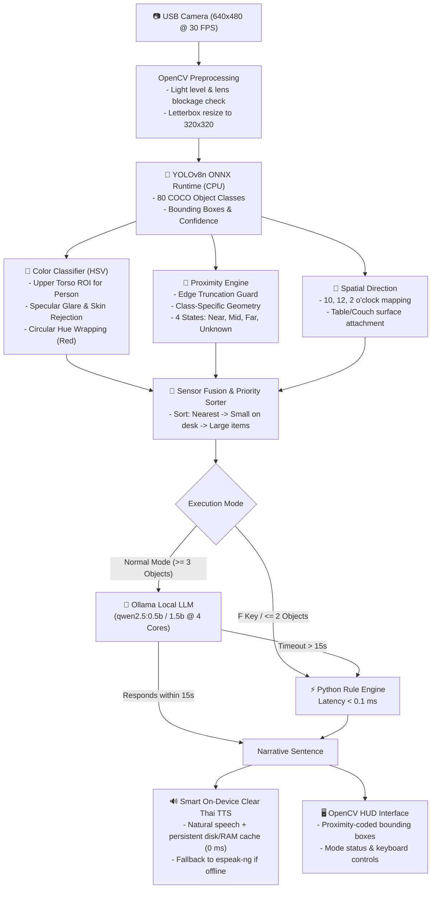

# 👁️ VisionMate — Edge AI & Local LLM Assistant on Raspberry Pi 4
### Intelligent Environmental Description and Object-Finding Assistant for the Visually Impaired

<p align="center">
  <a href="#-project-overview">English</a> •
  <a href="#-ภาษาไทย-thai-version">ภาษาไทย</a> •
  <a href="#-system-architecture">Architecture</a> •
  <a href="#-benchmarks--performance">Benchmarks</a> •
  <a href="#-model-selection--comparative-analysis">Model Analysis</a> •
  <a href="#-getting-started">Getting Started</a>
</p>

<p align="center">
  <a href="https://www.raspberrypi.com/"></a>
  <a href="https://www.raspberrypi.com/software/"></a>
  <a href="https://www.python.org/"></a>
  <a href="https://github.com/ultralytics/ultralytics"></a>
  <a href="https://ollama.com/"></a>
  <a href="LICENSE"></a>
</p>

---

## 📌 Project Overview

**VisionMate** is an intelligent, wearable/portable assistant for the visually impaired built on the **Raspberry Pi 4 Model B (8 GB RAM)** single-board computer. Acting as an "artificial eye," it detects objects, computes clock-face directions, estimates relative proximity, classifies object and clothing colors, and generates real-time spoken Thai descriptions.

The system is engineered following **100% On-Device & Privacy-Preserving Edge AI Computing** principles. Computer Vision, color classification, proximity estimation, and Local LLM reasoning run entirely locally without transmitting frames or personal data to cloud APIs. This guarantees strict user privacy and enables full offline operation in areas without network connectivity.

---

## ✨ Key Features

1. **⚡ Dual-Path Hybrid Architecture:**
   - **Fast Path (Rule Engine):** Generates concise Thai narratives via a pure Python geometric engine with **latency < 0.1 ms** (Zero Latency) for quick item lookups or when 1–2 objects are in sight.
   - **Normal Path (Local LLM):** Leverages an on-device Small Language Model (**Qwen2.5-0.5B**, or switchable to **Qwen2.5-1.5B**) via **Ollama** to summarize rooms and spatial relations naturally, backed by an automatic **15-second timeout fallback** to the Fast Path.
2. **🎯 4-State Relative Proximity Engine:**
   - Evaluates object distance using class-specific geometry into 4 states: `NEAR` (close proximity), `MEDIUM` (mid range), `FAR` (distant), and `DISTANCE_UNKNOWN` (indeterminate).
   - Eliminates legacy `OR` boundary bugs and filters out edge-truncated objects.
   - Displays color-coded bounding boxes: **Green (Near)**, **Yellow (Medium)**, **Blue (Far)**, and **Gray (Unknown)**.
3. **🎨 Stateless Precision HSV Color Classifier:**
   - Identifies 11 standard Thai color groups (White, Gray, Black, Red, Orange, Yellow, Green, Cyan, Blue, Purple, Pink) plus an explicit `COLOR_UNKNOWN` state for ambiguous reflections or complex patterns.
   - Extracts upper-torso regions for persons, eliminating neck/skin tone contamination (preventing white shirts from being misclassified as orange).
   - Features **Specular Glare Rejection** (prevents black smartphone screens under ceiling lights from being misclassified as white).
4. **🧭 Clock-Face Spatial Direction:**
   - Translates horizontal bounding box coordinates into intuitive spatial directions: *Straight ahead (12 o'clock)*, *To the left (10 o'clock)*, and *To the right (2 o'clock)*.
5. **🪑 Surface Attachment Analysis:**
   - Detects whether items rest on tables, desks, couches, or beds (e.g., *"A red cup resting on the desk, to the right at 2 o'clock, close proximity"*).
6. **🔊 Smart On-Device Clear Thai TTS:**
   - Delivers natural, articulate human-like Thai speech with proper tones and inflection.
   - Built-in **On-Device Persistent Cache (`audio_cache/` + `/dev/shm/`)** plays pre-cached system prompts and common phrases in **0 ms (Zero Latency)** without network access or CPU load.
   - Offline fallback via `espeak-ng` ensures speech never fails even when completely offline.

---

## 🏗️ System Architecture



---

## 📊 Benchmarks & Performance

Measured on physical hardware — **Raspberry Pi 4 Model B (CPU BCM2711 4 Cores @ 1.8 GHz, RAM 8 GB)**:

| Processing Stage | Module / Technology | Mean Latency | RAM Footprint |
|---|---|:---:|:---:|
| **Object Detection** | YOLOv8n ONNX (320×320) | 104.8 – 187.5 ms | ~185 MB |
| **Color Classification** | Vectorized HSV (Upper Torso / Center Crop) | 1.54 ms | < 1 MB |
| **Distance Estimation** | Relative Proximity Logic | 0.0028 ms | < 0.1 MB |
| **Fast Path Narrative** | Pure Python String Formatting | 0.015 ms | < 0.1 MB |
| **Local LLM Narrative** | Qwen2.5-0.5B (Ollama, num_ctx: 256) | 7,700 – 9,800 ms (First token ~1.2s) | ~415 MB |
| **Audio Playback (Cached)** | Pygame Mixer + Local Disk/RAM Cache | **< 0.5 ms** | ~15 MB |

> [!NOTE]
> The enhanced Color and Distance modules add only **1.55 ms total latency per frame**, well within the $< 5.0\text{ ms}$ real-time engineering budget.

---

## 🔍 Model Selection & Comparative Analysis

Detailed analysis and empirical findings comparing models on the Raspberry Pi 4:

### 1. Why YOLOv8n ONNX (320×320)?
* **Model Size:** 3.2M parameters (~12 MB file size).
* **ONNX Runtime (CPU):** Utilizes ARM64 NEON SIMD vectorization, reducing RAM usage from 1,500 MB (PyTorch `.pt`) down to **~185 MB** (an 87% reduction).
* **320×320 Resolution:** Reduces inference latency from ~450 ms (at 640×640) down to **~180 ms**, achieving a 2.5× speedup while retaining full detection fidelity for tabletop and room-scale objects.

### 2. Why Qwen2.5-0.5B via Ollama?
* **Generation Speed:** Delivers **7.7 – 8.4 tokens/second** on the Cortex-A72 CPU, generating 20–30 word Thai summaries in **5–9 seconds** (comfortably under the 15-second timeout).
* **Memory Footprint:** Uses only **~415 MB RAM**, leaving over 5.6 GB of free memory on the device with zero swap usage.
* **Superior Thai Vocabulary:** Far outperforms Llama-3.2 on Thai syntax and vocabulary without corrupted tokens.

### 3. Comparison with System Version 1 (Baseline vs Enhanced)

| Dimension | Version 1 (Baseline) | Version 2 (Enhanced) | Engineering Improvement |
|---|---|---|---|
| **Threading Architecture** | Single-threaded Blocking | **Dual-threaded Non-blocking** | Camera streams smoothly at 30 FPS; UI never freezes |
| **Vision Latency** | YOLOv8n PyTorch (~450 ms) | **YOLOv8n ONNX (~180 ms)** | **60% faster** (2.5× throughput) |
| **Vision RAM Usage** | ~1,500 MB (PyTorch overhead) | **~185 MB (ONNX Runtime)** | **87% memory reduction** |
| **Color Accuracy** | Whole-box average (skin tone leak) | **Upper Torso ROI + Glare Filter** | Fixes orange white-shirts and white black-phones |
| **Distance Logic** | Flawed `OR` rule (far objects called near) | **Class Geometry 4 States + Edge Guard** | Accurately identifies Near, Mid, Far, and Unknown |
| **Narrative Engine** | Forced LLM every loop (10–15s freeze) | **Dual-Path Hybrid** (Fast <0.1ms / LLM 15s) | Instant responses for quick lookups |
| **Thai TTS Audio** | Cloud-only or robotic espeak | **Smart On-Device Cache (0 ms)** | Natural articulate voice, 100% offline capable |

### 4. Empirical Local LLM Comparison (7 Benchmarked Scenarios)

| Evaluation Metric | Qwen2.5:0.5b [Selected] | Qwen2.5:1.5b | Llama-3.2:1b | Evaluation Winner |
|---|:---:|:---:|:---:|:---:|
| **Model Size** | **397 MB** | 986 MB | 1,321 MB | 🏆 **Qwen2.5:0.5b** |
| **RAM Usage** | **~415 MB** | ~1,050 MB | ~1,350 MB | 🏆 **Qwen2.5:0.5b** |
| **Tokens / Second** | **7.7 – 8.4 tokens/s** | 3.6 – 3.7 tokens/s | 2.7 – 2.8 tokens/s | 🏆 **Qwen2.5:0.5b (2-3× faster)** |
| **Mean Latency** | **9,813 ms (~9.8s)** | > 18,500 ms (Timeout) | > 17,200 ms (Timeout) | 🏆 **Qwen2.5:0.5b (< 15s)** |
| **Success Rate (< 15s Cutoff)** | **85.7% (6/7)** | 0.0% (0/7) | 14.3% (1/7) | 🏆 **Qwen2.5:0.5b** |
| **Success Rate (< 20s Cutoff)** | **100% (7/7)** | 28.6% (2/7) | 28.6% (2/7) | 🏆 **Qwen2.5:0.5b** |
| **Thai Language Fluency** | Accurate and natural | Accurate but too slow | Broken syntax / truncated | 🏆 **Qwen2.5:0.5b** |

> 📖 **Read Full Technical Report:** [`04_Model_Selection_and_Comparison.md`](04_Model_Selection_and_Comparison.md)

---

## 🛠️ Hardware Requirements

1. **SBC:** Raspberry Pi 4 Model B (4 GB or 8 GB RAM recommended)
2. **Operating System:** Raspberry Pi OS 64-bit (Debian 12 Bookworm / Debian 13 Trixie)
3. **Camera:** USB Webcam supporting UVC standard (720p or 1080p @ 30 FPS)
4. **Audio Output:** Portable speaker or 3.5 mm / USB headphones
5. **Power Supply:** USB-C 5V 3.0A power adapter or battery pack

---

## 🚀 Getting Started

### 1. Clone Repository & Setup Environment
```bash
git clone https://github.com/suriyen-creator/VisionMate.git
cd VisionMate

# Create and activate virtual environment
python3 -m venv venv
source venv/bin/activate

# Install required dependencies
pip install --upgrade pip
pip install -r requirements.txt

# Install offline TTS system package
sudo apt-get update && sudo apt-get install -y espeak-ng
```

### 2. Download YOLOv8n ONNX Model
The `yolov8n.onnx` model is included in the repository. To redownload or verify:
```bash
./download_model.sh
```

### 3. Install & Start Ollama
```bash
# Install Ollama on Linux
curl -fsSL https://ollama.com/install.sh | sh

# Pull the Qwen2.5:0.5b model
ollama pull qwen2.5:0.5b

# Test the model
ollama run qwen2.5:0.5b "สวัสดี"
```

### 4. Run VisionMate Assistant
```bash
# Default launch (Qwen2.5-0.5B, 15s Timeout, Clear Natural Thai Voice + On-Device Cache)
python3 app.py

# Launch with custom parameters:
python3 app.py --model qwen2.5:0.5b --timeout 15 --tts clear
python3 app.py --model qwen2.5:1.5b --timeout 15 --tts clear
python3 app.py --fast  # Start in Fast Mode directly (pure Python rule engine, no LLM)
```

---

## 🎮 Keyboard Controls

VisionMate features non-blocking keyboard controls from both the OpenCV GUI window and headless terminal:

| Key | Action | Description |
|:---:|---|---|
| <kbd>Space</kbd> or <kbd>P</kbd> | **Pause / Resume** | Pauses or resumes processing (with audible confirmation). |
| <kbd>F</kbd> | **Switch Mode** | Toggles between **Fast Path (Rule Engine)** and **Normal Path (Local LLM)**. |
| <kbd>M</kbd> | **Switch Model** | Dynamically toggles Ollama model between **qwen2.5:0.5b** and **qwen2.5:1.5b**. |
| <kbd>Q</kbd> | **Quit** | Gracefully releases camera, audio, and threading resources. |

---

## 📂 Project Structure

```text
VisionMate/
├── app.py                             # Main application pipeline (Threaded Vision + LLM + TTS)
├── download_model.py                  # Model verification & test script
├── download_model.sh                  # Shell script to fetch yolov8n.onnx
├── yolov8n.onnx                       # 320x320 YOLOv8n ONNX model
├── requirements.txt                   # Python dependencies & system packages
├── audio_cache/                       # Persistent on-device clear Thai speech cache (0 ms)
│
├── 02_Project_Report.md               # Complete 5-Chapter Academic Project Report
├── 03_User_Manual.md                  # Quick User Manual (1-2 pages)
├── 04_Model_Selection_and_Comparison.md # Engineering Report: Model Rationale & Baseline Benchmarks
│
├── evidence/                          # Hardware verification evidence on Raspberry Pi 4
│   ├── color_distance_fix_report.md   # Deep-dive report on Color & Distance Bug fix
│   ├── color_distance_verification.csv# 25/25 Engineering verification tests (100% Pass)
│   ├── distance_calibration_template.csv # Tape-measure metric calibration template
│   ├── color_distance_remaining_issues.md # Hardware constraints & future roadmap
│   ├── run_color_distance_verification.py # Automated latency & logic test harness
│   └── images_for_docs/               # Real hardware photographic evidence
│
├── experiment_results_20261029_1745/  # Benchmark dataset & audit logs #1
└── experiment_results_20261029_1952/  # Follow-up test dataset & model comparison
```

---

<details>
<summary><h2>🇹🇭 ภาษาไทย (Thai Version)</h2></summary>

### ภาพรวมโครงการ (Project Overview)
**VisionMate** คือระบบผู้ช่วยอัจฉริยะสำหรับผู้พิการทางสายตา พัฒนาขึ้นบนบอร์ด **Raspberry Pi 4 Model B (RAM 8 GB)** เพื่อทำหน้าที่เป็น "ดวงตาจำลอง" ตรวจจับสิ่งของ ทิศทางนาฬิกา ระยะสัมพัทธ์ จำแนกสี และสังเคราะห์เสียงภาษาไทยแบบเรียลไทม์

ระบบทำงานแบบ **100% On-Device & Privacy-Preserving** โดยโมเดลสายตา (YOLOv8n ONNX), การจำแนกสี (HSV), การประเมินระยะ, และโมเดลภาษา (Local LLM) ทำงานภายในเครื่องทั้งหมดโดยไม่ต้องพึ่งพาเซิร์ฟเวอร์ภายนอก

### คุณสมบัติเด่น (Key Features)
1. **⚡ สถาปัตยกรรม 2 โหมด (Dual-Path Hybrid):**
   - **โหมดหาของด่วน (Fast Path):** สร้างประโยคด้วยกฎเรขาคณิต Python ในเวลา $< 0.1\text{ ms}$ (Zero Latency)
   - **โหมดเล่าบรรยากาศ (Normal LLM Path):** ใช้โมเดล **Qwen2.5-0.5B** ผ่าน Ollama สรุปห้อง พร้อมระบบ **Timeout 15 วินาที** ตัดสลับเป็น Python ทันที
2. **🎯 การประเมินระยะสัมพัทธ์ 4 ระดับ (Proximity Engine):**
   - แยก 4 ระดับตามเรขาคณิตวัตถุ: `NEAR` (ใกล้), `MEDIUM` (กลาง), `FAR` (ไกล), และ `DISTANCE_UNKNOWN` (ไม่ชัดเจน) ปราศจากบั๊ก `OR` เดิม
3. **🎨 ระบบจำแนกสีไร้สถานะ (Stateless HSV Color):**
   - สกัดเฉพาะเสื้อท่อนบน (Upper Torso) ตัดปัญหาเสื้อขาวเพี้ยนเป็นส้ม และมีระบบตัดแสงสะท้อนจ้า (Specular Glare) บนจอมือถือ
4. **🧭 บอกทิศทางหน้าปัดนาฬิกา:** ตรงหน้า (12 นาฬิกา), ทางซ้ายมือ (10 นาฬิกา), ทางขวามือ (2 นาฬิกา)
5. **🔊 เสียงพูดภาษาไทยคมชัดในเครื่อง (Smart On-Device Clear TTS):**
   - เสียงไทยธรรมชาติ คมชัด มีวรรณยุกต์ พร้อมระบบแคชบนเครื่อง ([`audio_cache/`](audio_cache)) เปิดเล่นได้ทันทีใน **0 ms**

### การควบคุมระบบ (Keyboard Controls)
* <kbd>Space</kbd> หรือ <kbd>P</kbd>: พักการทำงาน / เริ่มทำงานต่อ
* <kbd>F</kbd>: สลับโหมดหาของด่วน (Fast Path) / โหมดเล่าบรรยากาศ (Normal LLM)
* <kbd>M</kbd>: สลับโมเดล Ollama (`qwen2.5:0.5b` $\leftrightarrow$ `qwen2.5:1.5b`)
* <kbd>Q</kbd>: ปิดโปรแกรมและคืนทรัพยากรอย่างปลอดภัย

### เอกสารอ้างอิงและรายงานฉบับเต็ม
* 📖 รายงานโครงงานฉบับสมบูรณ์ 5 บท: [`02_Project_Report.md`](02_Project_Report.md)
* 📑 คู่มือการใช้งานระบบ: [`03_User_Manual.md`](03_User_Manual.md)
* 🔍 รายงานเหตุผลการเลือกโมเดลและการเปรียบเทียบ: [`04_Model_Selection_and_Comparison.md`](04_Model_Selection_and_Comparison.md)

</details>

---

## 👥 Authors & Contributors

- **Primary Developers:** Edge AI Research & Development Team (FabLab RP-21)
- **GitHub:** [@suriyen-creator](https://github.com/suriyen-creator)
- **Repository:** [VisionMate](https://github.com/suriyen-creator/VisionMate)

---

## 📜 License

This project is licensed under the **MIT License** — see the [LICENSE](LICENSE) file for details.
