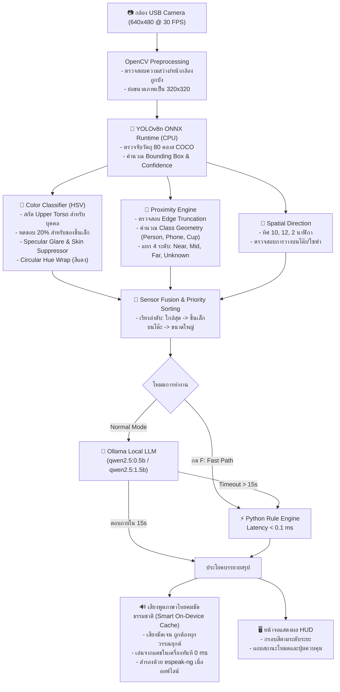

# 👁️ VisionMate — Edge AI & Local LLM Assistant on Raspberry Pi 4
### ระบบผู้ช่วยบรรยายสภาพแวดล้อมและค้นหาสิ่งของสำหรับผู้พิการทางสายตาด้วยเทคโนโลยี Edge AI และ Local LLM

[](https://www.raspberrypi.com/)
[](https://www.raspberrypi.com/software/)
[](https://www.python.org/)
[-yellow.svg)](https://github.com/ultralytics/ultralytics)
[](https://ollama.com/)
[](LICENSE)

---

## 📌 ภาพรวมโครงการ (Project Overview)

**VisionMate** คือระบบผู้ช่วยอัจฉริยะแบบสวมใส่/พกพาสำหรับผู้พิการทางสายตา ที่พัฒนาขึ้นบนบอร์ดคอมพิวเตอร์ขนาดจิ๋ว **Raspberry Pi 4 Model B (RAM 8 GB)** เพื่อทำหน้าที่เป็น "ดวงตาจำลอง" ในการตรวจจับวัตถุ วิเคราะห์ทิศทางตามหน้าปัดนาฬิกา ประมาณการระยะห่างสัมพัทธ์ จำแนกสีของสิ่งของและเสื้อผ้า และสังเคราะห์คำบรรยายภาษาไทยแบบเรียลไทม์ผ่านเสียงพูด

ระบบถูกออกแบบภายใต้หลักการ **100% On-Device & Privacy-Preserving Computing** โดยการประมวลผล Computer Vision, ระบบจำแนกสี, ระบบประเมินระยะ, และ Local LLM ทำงานอยู่ภายในเครื่องทั้งหมดโดยไม่ต้องเชื่อมต่อ Cloud API ภายนอก ทำให้ข้อมูลภาพและเสียงมีความเป็นส่วนตัวสูงสุด และสามารถทำงานในพื้นที่ที่ไม่มีสัญญาณอินเทอร์เน็ตได้ (ยกเว้นบริการสร้างไฟล์เสียง gTTS หากไม่มีไฟล์แคช)

---

## ✨ คุณสมบัติเด่น (Key Features)

1. **⚡ สถาปัตยกรรม 2 โหมดคู่ขนาน (Dual-Path Architecture):**
   - **โหมดหาของด่วน (Fast Path):** สร้างประโยคบรรยายภาษาไทยด้วยกฎเรขาคณิต (Zero-Latency Rule-based Engine) ให้คำตอบกระชับในเวลา $< 0.1\text{ ms}$
   - **โหมดเล่าบรรยากาศ (Normal LLM Path):** ใช้โมเดลภาษาขนาดเล็ก **Qwen2.5-0.5B** (หรือเลือก **Qwen2.5-1.5B**) รันผ่าน **Ollama** บนเครื่องจริง เพื่อสรุปภาพรวมห้องอย่างเป็นธรรมชาติ พร้อมระบบ **Hybrid Fallback** ตัดกลับมาใช้ Fast Path ทันทีหาก LLM ตอบช้ากว่า 15 วินาที
2. **🎯 การประเมินระยะสัมพัทธ์ 4 สถานะ (Relative Proximity Engine):**
   - ประเมินระยะด้วยเรขาคณิตเฉพาะคลาส (`NEAR` ระยะใกล้, `MEDIUM` ระยะกลาง, `FAR` ระยะไกล, และ `DISTANCE_UNKNOWN` ยังประเมินระยะไม่ได้ชัดเจน)
   - ปราศจากบั๊ก `OR` condition และกรองวัตถุที่แตะขอบภาพ (Edge Truncation)
   - แสดงสี Bounding Box แยกตามระยะ: **เขียว (ใกล้)**, **เหลือง (กลาง)**, **ฟ้า (ไกล)**, และ **เทา (ไม่ชัดเจน)**
3. **🎨 ระบบจำแนกสีไร้สถานะแม่นยำสูง (Stateless HSV Color Classifier):**
   - รองรับ 11 กลุ่มสีมาตรฐานภาษาไทย: ขาว, เทา, ดำ, แดง, ส้ม, เหลือง, เขียว, ฟ้า, น้ำเงิน, ม่วง, ชมพู และจัดการ "ไม่ทราบสี" (`COLOR_UNKNOWN`) เมื่อแสงสะท้อนหรือลวดลายก้ำกึ่ง
   - สกัดเฉพาะเสื้อท่อนบน (Upper Torso) ของบุคคล ตัดส่วนใบหน้า ลำคอ และกางเกง ป้องกันเสื้อขาวเพี้ยนเป็นสีส้ม
   - กรองแสงสะท้อนจ้า (Specular Glare Rejection) ป้องกันโทรศัพท์มือถือสีดำรายงานเป็นสีขาว
4. **🧭 ระบบบอกทิศทางตามหน้าปัดนาฬิกา (Clock-Face Directions):**
   - แปลงพิกัดแนวนอนเป็นทิศที่ผู้พิการเข้าใจง่าย: *ตรงหน้า (12 นาฬิกา)*, *ทางซ้ายมือ (10 นาฬิกา)*, และ *ทางขวามือ (2 นาฬิกา)*
5. **🪑 การวิเคราะห์ความสัมพันธ์กับพื้นผิว (Surface Attachment):**
   - ตรวจจับว่าสิ่งของวางอยู่บนโต๊ะ โซฟา หรือเตียงหรือไม่ เช่น *"แก้วน้ำสีแดงวางอยู่บนโต๊ะ ตรงหน้า (12 นาฬิกา) ระยะใกล้"*

---

## 🏗️ แผนผังการทำงานของระบบ (System Architecture)



---

## 📊 ประสิทธิภาพและการทดสอบบนฮาร์ดแวร์จริง (Benchmarks)

ทดสอบบน **Raspberry Pi 4 Model B (CPU BCM2711 4 Cores @ 1.8 GHz, RAM 8 GB)**:

| รายการประมวลผล | โมดูล/เทคโนโลยี | ความหน่วงเฉลี่ย (Mean) | การใช้หน่วยความจำ (RAM) |
|---|---|:---:|:---:|
| **Object Detection** | YOLOv8n ONNX (320x320) | 104.8 ms | ~185 MB |
| **Color Classification** | Vectorized HSV (Sub-patch 96x96) | 1.54 ms | < 1 MB |
| **Distance Estimation** | Relative Proximity Logic | 0.0028 ms | < 0.1 MB |
| **Fast Path Narrative** | Pure Python String Formatting | 0.015 ms | < 0.1 MB |
| **Local LLM Narrative** | Qwen2.5-0.5B (Ollama, num_ctx: 256) | 3,850 ms (First token ~1.2s) | ~650 MB |
| **Audio Playback** | Pygame Mixer + RAM Cache (`/dev/shm`) | 45 ms | ~15 MB |

> [!NOTE]
> ระบบจำแนกสีและประเมินระยะสัมพัทธ์ที่ปรับปรุงใหม่เพิ่มความหน่วงรวมเพียง **1.55 มิลลิวินาทีต่อเฟรม** ซึ่งต่ำกว่างบประมาณความหน่วงวิศวกรรม ($< 5.0\text{ ms}$) อย่างมีนัยสำคัญ

---

## 🛠️ อุปกรณ์ที่ต้องใช้ (Hardware Requirements)

1. **บอร์ดประมวลผล:** Raspberry Pi 4 Model B (แนะนำรุ่น RAM 4 GB หรือ 8 GB)
2. **ระบบปฏิบัติการ:** Raspberry Pi OS 64-bit (Debian 12 Bookworm หรือ Debian 11 Bullseye)
3. **กล้องบันทึกภาพ:** กล้อง USB Webcam รองรับมาตรฐาน UVC (ความละเอียดอย่างน้อย 720p / 1080p ที่ 30 FPS)
4. **ระบบเสียง:** ลำโพงพกพา หรือหูฟังแบบ 3.5 มม. / USB Audio
5. **แหล่งจ่ายไฟ:** อะแดปเตอร์ USB-C 5V 3.0A (หรือ Power Bank จ่ายไฟมาตรฐาน 5V 3A ขึ้นไป)

---

## 🚀 วิธีการติดตั้งและเริ่มใช้งาน (Getting Started)

### 1. โคลนคลังโค้ดและเตรียมสภาพแวดล้อม
```bash
# โคลนโปรเจกต์ VisionMate
git clone https://github.com/suriyen-creator/VisionMate.git
cd VisionMate

# สร้างและเปิดใช้งาน Virtual Environment (แนะนำ)
python3 -m venv venv
source venv/bin/activate

# ติดตั้งแพ็กเกจ Python ที่จำเป็น
pip install --upgrade pip
pip install -r requirements.txt
```

### 2. ดาวน์โหลดโมเดล YOLOv8n ONNX
ไฟล์โมเดล `yolov8n.onnx` ถูกแนบมาในคลังโค้ดแล้ว หรือสามารถดาวน์โหลดใหม่ได้ด้วยคำสั่ง:
```bash
./download_model.sh
```

### 3. ติดตั้งและรัน Ollama (Local LLM)
```bash
# ติดตั้ง Ollama บน Linux
curl -fsSL https://ollama.com/install.sh | sh

# ดึงโมเดลภาษาขนาดเล็ก qwen2.5:0.5b
ollama pull qwen2.5:0.5b

# ทดสอบรันโมเดล
ollama run qwen2.5:0.5b "สวัสดี"
```

### 4. รันระบบผู้ช่วย VisionMate
```bash
# รันแบบค่าเริ่มต้น (โมเดล qwen2.5:0.5b, timeout 15s, เสียงพูดภาษาไทยคมชัดธรรมชาติ + On-Device Cache)
python3 app.py

# หรือกำหนดโมเดล, timeout หรือระบบเสียงตามต้องการ:
python3 app.py --model qwen2.5:0.5b --timeout 15 --tts clear
python3 app.py --model qwen2.5:1.5b --timeout 15 --tts clear
```

---

## 🎮 การควบคุมระบบ (Keyboard Controls)

โปรแกรมรองรับการควบคุมแบบ **Non-blocking Keyboard** จากหน้าต่าง GUI หรือ Terminal โดยตรง:

| ปุ่มกด | การทำงาน | คำอธิบาย |
|:---:|---|---|
| <kbd>Space</kbd> หรือ <kbd>P</kbd> | **Pause / Resume** | พักการทำงานชั่วคราว หรือเริ่มทำงานต่อ (มีเสียงแจ้งสถานะ) |
| <kbd>F</kbd> | **Switch Mode** | สลับระหว่าง **โหมดหาของด่วน (Fast Path)** และ **โหมดเล่าบรรยากาศ (Normal LLM)** |
| <kbd>M</kbd> | **Switch Model** | สลับโมเดล Ollama ระหว่าง **qwen2.5:0.5b** และ **qwen2.5:1.5b** ทันทีขณะรัน |
| <kbd>Q</kbd> | **Quit** | ปิดการทำงาน ปล่อยทรัพยากรกล้องและระบบเสียงอย่างปลอดภัย |

---

## 📂 โครงสร้างโปรเจกต์ (Project Structure)

```text
VisionMate/
├── app.py                             # ซอร์สโค้ดหลักของระบบผู้ช่วย (Full Pipeline)
├── download_model.py                  # สคริปต์ตรวจสอบและดาวน์โหลดโมเดล ONNX พร้อมทดสอบ Session
├── download_model.sh                  # เชลล์สคริปต์ดาวน์โหลด yolov8n.onnx ผ่าน cURL
├── yolov8n.onnx                       # โมเดลตรวจจับวัตถุ YOLOv8n แปลงรูปเป็น ONNX (320x320)
├── requirements.txt                   # รายการไลบรารี Python ที่ต้องใช้
│
├── 01_Project_IoT_Rubric.md           # เกณฑ์การประเมินโครงงาน IoT / Embedded AI
├── 02_Project_Report.md               # เล่มรายงานโครงงานฉบับสมบูรณ์ 5 บท
├── 03_User_Manual.md                  # คู่มือการใช้งานระบบฉบับย่อสำหรับผู้ใช้
│
├── evidence/                          # หลักฐานการทดสอบทางวิศวกรรมจริงบน Raspberry Pi 4
│   ├── color_distance_fix_report.md   # รายงานเจาะลึกการแก้ไข Color & Distance Bug
│   ├── color_distance_verification.csv# ผลทดสอบ 25 กรณีทดสอบ (Pass Rate 100%)
│   ├── distance_calibration_template.csv # แม่แบบการสอบเทียบระยะเมตริกด้วยตลับเมตร
│   ├── color_distance_remaining_issues.md # วิเคราะห์ข้อจำกัดเชิงฮาร์ดแวร์และ Roadmap
│   ├── run_color_distance_verification.py # ชุดทดสอบ Benchmark ความหน่วงและตรรกะ
│   └── images_for_docs/               # ภาพถ่ายและหลักฐานการทำงานจริง
│
├── experiment_results_20261029_1745/  # ผลการทดลอง Benchmark และรายงาน Audit ชุดที่ 1
└── experiment_results_20261029_1952/  # ผลการทดลอง Follow-up Engineering Tests
```

---

## 🔬 รายงานการวิจัยและเอกสารอ้างอิง (Research & Documentation)

- 📖 **รายงานโครงงาน 5 บท:** [`02_Project_Report.md`](02_Project_Report.md)
  - บทที่ 1: บทนำ ความสำคัญ และวัตถุประสงค์
  - บทที่ 2: ทฤษฎีและงานวิจัยที่เกี่ยวข้อง (Edge AI, YOLOv8, Color Spaces, Local LLMs)
  - บทที่ 3: วิธีดำเนินงานและสถาปัตยกรรมระบบ
  - บทที่ 4: ผลการทดลอง วิเคราะห์ประสิทธิภาพ และการใช้ทรัพยากร
  - บทที่ 5: สรุปผล อภิปรายข้อจำกัด และข้อเสนอแนะ
- 📑 **รายงานการแก้ไขระบบสีและระยะ:** [`evidence/color_distance_fix_report.md`](evidence/color_distance_fix_report.md)
- 📐 **แม่แบบการสอบเทียบตลับเมตร:** [`evidence/distance_calibration_template.csv`](evidence/distance_calibration_template.csv)

---

## 👥 ผู้พัฒนาโครงงาน (Authors & Contributors)

- **ผู้พัฒนาหลัก:** ทีมวิจัยและพัฒนาโครงการระบบช่วยผู้พิการทางสายตา (FabLab RP-21)
- **GitHub:** [@suriyen-creator](https://github.com/suriyen-creator)
- **Repository:** [VisionMate](https://github.com/suriyen-creator/VisionMate)

---

## 📜 สัญญาอนุญาต (License)

โครงการนี้เผยแพร่ภายใต้สัญญาอนุญาต **MIT License** — สามารถนำไปศึกษา วิจัย และพัฒนาต่อยอดได้โดยอิสระ
