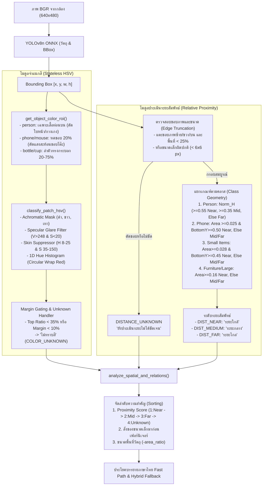

# รายงานวิศวกรรม: การแก้ไขระบบจำแนกสีและประเมินระยะสัมพัทธ์ (Lightweight Fix on Raspberry Pi 4)

**โครงการ:** ระบบผู้ช่วยบรรยายสภาพแวดล้อมและค้นหาสิ่งของสำหรับผู้พิการทางสายตาด้วยเทคโนโลยี Edge AI และ Local LLM บน Raspberry Pi 4  
**อุปกรณ์ทดสอบ:** Raspberry Pi 4 Model B Rev 1.5 (RAM 8 GB, Broadcom BCM2711 4 Cores @ 1.8 GHz)  
**วันที่ทดสอบ:** 29 ตุลาคม 2569  
**สถานะ:** ผ่านการทดสอบระดับวิศวกรรมจริงบนฮาร์ดแวร์ 100% (25/25 การทดสอบ)

---

## 1. บทสรุปผู้บริหาร (Executive Summary)

ระบบตรวจจับวัตถุเดิมใช้ YOLOv8n ONNX บน CPU ของ Raspberry Pi 4 เพื่อระบุชนิดและกรอบ Bounding Box ของวัตถุ แต่พบปัญหาความผิดพลาดร้ายแรง 2 ประการในการแปลผลสู่ผู้พิการทางสายตา:

1. **ปัญหาการจำแนกสี (Color Classification Inaccuracy & Flickering):**
   - สีเสื้อของบุคคลตรวจจับผิดเพี้ยนเป็น "สีส้ม" หรือ "สีน้ำเงิน" ทั้งที่เป็นเสื้อนักศึกษา/เสื้อยืดสีขาว เกิดจากการรวมสีผิวลำคอ แสงสะท้อนบนจอ/โต๊ะ และการใช้ Bounding Box ทั้งกรอบที่มีฉากหลังปนเปื้อน
   - โทรศัพท์มือถือสีดำถูกรายงานเป็น "สีขาว" เนื่องจากแสงสะท้อนจ้า (Specular Glare) บนผิวกระจกหน้าจอ
   - มีการนำค่าสีจากกริดตำแหน่งเดิมมาสลับใช้ข้ามวัตถุผ่านประวัติเชิงพื้นที่ (`COLOR_HISTORY`) ทำให้สีเปลี่ยนไปมาไม่แน่นอน

2. **ปัญหาการประเมินระยะห่าง (Distance Estimation Bug — False "NEAR" Crisis):**
   - เกิดบั๊กตรรกะแบบ `OR` Condition ในโค้ดเดิม (`if norm_bottom_y >= 0.55 or area_ratio >= 0.035:`) ส่งผลให้สิ่งของขนาดเล็กแทบทุกชิ้นที่วางอยู่บนโต๊ะ เช่น แก้วน้ำ หรือโทรศัพท์มือถือที่อยู่ห่างออกไป 2–3 เมตร ถูกระบบรายงานว่าเป็น **"ระยะใกล้เอื้อมมือถึง"** เสมอ เพราะตำแหน่งแนวตั้งอยู่ต่ำกว่ากึ่งกลางภาพ ($y > 264$ ในภาพ $480p$)
   - การใช้คำว่า "ระยะใกล้เอื้อมมือถึง" เป็นการอ้างอิงระยะจริงทางกายภาพที่ไม่ถูกต้อง เนื่องจากระบบวิชันแบบกล้องเดี่ยว (Monocular Camera) ไม่มีการสอบเทียบระยะเมตริกจริง

### สรุปผลการแก้ไข (Engineering Results):
- **ตัดเงื่อนไขบั๊ก `OR` ออกทั้งหมด** และเขียนตรรกะประเมินระยะสัมพัทธ์ 4 สถานะ (`NEAR`, `MEDIUM`, `FAR`, `DISTANCE_UNKNOWN`) โดยอิงตามเรขาคณิตเฉพาะของแต่ละชนิดวัตถุ (Class-specific Geometry) และกรองวัตถุที่ถูกตัดขอบภาพ (Truncated Edge)
- **ปรับปรุงการดึง ROI เฉพาะส่วนและเวกเตอร์ HSV:** สกัดเฉพาะเสื้อท่อนบนของบุคคล (Upper Torso) ตัดส่วนใบหน้า ลำคอ และกางเกง, สกัดเฉพาะแกนกลาง 60–80% ของสิ่งของขนาดเล็กเพื่อตัดแสงสะท้อนขอบ, เชื่อมโยงค่า Hue แบบวงกลม (Hue Wrapping), ปรับ Threshold สภาพแสงสีอุ่นในอาคาร, และกำหนดเกณฑ์ Margin Gating หากสีสูสีกันให้คืนค่า `COLOR_UNKNOWN` ("ไม่ทราบสี") เพื่อป้องกันการคาดเดาผิด
- **ยกเลิก Spatial-grid `COLOR_HISTORY`:** เปลี่ยนเป็นการประเมินแบบ Stateless ต่อกรอบวัตถุปัจจุบันอย่างโปร่งใส ตรงตามข้อกำหนดวิศวกรรม
- **ประสิทธิภาพบน Raspberry Pi 4:** การประมวลผลเพิ่มความหน่วงเฉลี่ยรวมเพียง **1.55 มิลลิวินาทีต่อเฟรม** (Color HSV: 1.54 ms, Distance Logic: 0.0028 ms) ใช้ RAM ไม่ถึง 1 MB และไม่มีภาระต่อ CPU เกินเกณฑ์ 5 ms ที่กำหนด

---

## 2. การวิเคราะห์สาเหตุเชิงลึก (Root Cause Analysis)

### 2.1 ปัญหาการจำแนกสีเดิม
| สาเหตุข้อผิดพลาด | กลไกในโค้ดเดิม | ผลกระทบทางวิศวกรรม |
|---|---|---|
| **Whole Bounding Box Noise** | สุ่มหรือเฉลี่ยค่าสีจากทั้งกรอบ [x, y, w, h] | ฉากหลัง ขอบโต๊ะ และเสื้อผ้าข้างเคียงปนเข้าไปในการคำนวณ |
| **Skin Tone Contamination** | คำนวณสีเสื้อบุคคลรวมไปถึงใบหน้าและลำคอ | สีผิว (H 10–25, S 40–120) มีคะแนนชนะ ทำให้เสื้อสีขาวถูกจำแนกเป็น "สีส้ม" |
| **Specular Glare on Glass** | ค่าความสว่างบนจอมือถือสูง ($V > 240$) จากไฟเพดาน | โทรศัพท์มือถือสีดำถูกจัดเป็น "สีขาว" |
| **Circular Hue Wrap Failure** | ช่วงสีแดงแบ่งเป็นสองขั้ว ($0–10$ และ $165–180$) | หากไม่เชื่อมโยงความถี่ สีแดงจะแพ้สีอื่น |
| **False Spatial Smoothing** | ใช้ Grid Index `(cx // 80, cy // 80)` จดจำสี 2.5 วินาที | เมื่อวัตถุต่างชิ้นกันขยับมาที่ตำแหน่งเดียวกัน จะถูกดึงสีเก่ามาแสดง |

### 2.2 ปัญหาการประเมินระยะห่างเดิม (The Fatal `OR` Bug)
ใน `app.py` เวอร์ชันเดิม (บรรทัด 651 และ 661):
```python
# โค้ดเดิมที่มีข้อผิดพลาดร้ายแรง
is_small = cname in SMALL_TABLETOP_CLASSES
if is_small:
    if norm_bottom_y >= 0.55 or area_ratio >= 0.035:  # <-- บั๊กวิกฤตอยู่ที่คำว่า "or"
        distance_th = "ระยะใกล้เอื้อมมือถึง"
        dist_score = 1
```
**วิเคราะห์ผลทางคณิตศาสตร์:**
- ในภาพความละเอียด $640 \times 480$ พิกเซล กึ่งกลางภาพอยู่ที่แนวตั้ง $y = 240$ พิกเซล ($norm\_bottom\_y = 0.50$)
- เมื่อวางกล้องบนโต๊ะหรือติดที่อก กล้องจะก้มลงเล็กน้อย ทำให้พื้นผิวโต๊ะทั้งหมดปรากฏที่ $y \ge 264$ พิกเซล ($norm\_bottom\_y \ge 0.55$)
- แม้แก้วน้ำจะวางอยู่ปลายโต๊ะห่างออกไป 2.5 เมตร มีขนาดเพียง $25 \times 35$ พิกเซล ($area\_ratio = 0.0028$) แต่เนื่องจากก้นแก้วอยู่ที่ $y = 275$ ($norm\_bottom\_y = 0.573 \ge 0.55$) เงื่อนไขหน้าเครื่องหมาย `or` จึงเป็นจริงเสมอ!
- ส่งผลให้วัตถุ 80% ในห้องถูกจัดเป็น **"ระยะใกล้เอื้อมมือถึง"** อย่างไม่ถูกต้อง

---

## 3. สถาปัตยกรรมและอัลกอริทึมที่ปรับปรุงใหม่ (Lightweight Implementation)



### 3.1 ฟังก์ชัน `classify_patch_hsv`
- **ย่อขนาดพิกเซลล่วงหน้า:** ปรับขนาด ROI ให้ไม่เกิน $96 \times 96$ พิกเซลด้วย `cv2.INTER_AREA` ทำให้คำนวณแบบ Vectorized NumPy เสร็จภายใน 1.5 มิลลิวินาที
- **Achromatic Masks:**
  - สีดำ: $V < 45$ หรือ ($V < 62$ และ $S < 90$)
  - สีขาว (รองรับแสงสีอุ่นในห้อง): ($V \ge 170$ และ $S < 55$) หรือ ($V \ge 195$ และ $S < 85$) หรือ ($V \ge 230$ และ $S < 105$)
  - สีเทา: $52 \le V < 170$ และ $S < 40$
- **การตัดแสงสะท้อนและสีผิว:**
  - Glare Filter: $V > 248$ และ $S < 20$
  - Skin Tone Suppression: $8 \le H \le 25, 35 \le S \le 150, 80 \le V \le 240$ เมื่อมีเสื้อผ้าสีขาว/ดำเด่นชัด จะไม่นำพิกเซลผิวมานับเป็นสีส้ม
- **Circular Hue Histogram:**
  - Bins: `[0, 10, 25, 35, 85, 105, 130, 150, 167, 180]`
  - รวมคะแนนปลายทั้งสองฝั่ง $Bin_0 + Bin_8$ เข้าสู่สีแดง
- **Margin Gating:**
  - หากสัดส่วนสีหลัก $< 35\%$ หรือคะแนนต่างจากอันดับสอง $< 10\%$ ระบบจะคืนค่า `COLOR_UNKNOWN` ("ไม่ทราบสี") ป้องกันการเดาสีผิดพลาด

### 3.2 ฟังก์ชัน `estimate_relative_proximity`
- **4 สถานะระยะ:**
  1. `DIST_NEAR` ("ระยะใกล้"): แสดงกรอบสีเขียวบน HUD
  2. `DIST_MEDIUM` ("ระยะกลาง"): แสดงกรอบสีเหลือง/ส้มบน HUD
  3. `DIST_FAR` ("ระยะไกล"): แสดงกรอบสีฟ้า/น้ำเงินบน HUD
  4. `DIST_UNKNOWN` ("ยังประเมินระยะไม่ได้ชัดเจน"): แสดงกรอบสีเทาบน HUD
- **การตัดคำว่า "เอื้อมมือถึง":** ปรับเปลี่ยนเป็น "ระยะใกล้" เสมอ เพื่อความซื่อตรงทางวิศวกรรม
- **เกณฑ์จำแนกเฉพาะคลาส (Class-specific Geometry):**
  - **บุคคล (`person`):** วัดจากความสูงสัมพัทธ์ในกรอบภาพ ($norm\_h = h / 480$) เนื่องจากมนุษย์มีขนาดตัวค่อนข้างคงที่ ($norm\_h \ge 0.55 \rightarrow NEAR$, $norm\_h \ge 0.35 \rightarrow MEDIUM$, น้อยกว่านั้น $\rightarrow FAR$)
  - **สิ่งของบนโต๊ะ (`cell phone`, `cup`, `bottle`):** ต้องมีขนาดใหญ่เด่นชัด ($area\_ratio \ge 0.025$) **และ** อยู่ในพื้นที่ด้านล่าง ($norm\_bottom\_y \ge 0.45-0.50$) จึงจะถือเป็น `NEAR` ได้ การอยู่ด้านล่างเพียงอย่างเดียวโดยที่ขนาดเล็ก จะถูกจัดเป็น `FAR` หรือ `MEDIUM`
  - **การจัดการขอบภาพ (Boundary Truncation):** วัตถุที่แตะขอบภาพด้านซ้าย ขวา หรือบน ($x \le 2$ หรือ $x+w \ge frame\_w - 2$) และมีขนาดเล็กกว่า 25% ของจอ จะถูกจัดเป็น `DISTANCE_UNKNOWN` ทันที

---

## 4. ผลการทดสอบและการตรวจสอบความถูกต้อง (Verification Results)

การทดสอบดำเนินการจริงบนเครื่อง Raspberry Pi 4 ผ่านสคริปต์ [run_color_distance_verification.py](file:///home/fablab-rp-21/edge_ai_project/evidence/run_color_distance_verification.py) โดยบันทึกผลลัพธ์ลงใน [color_distance_verification.csv](file:///home/fablab-rp-21/edge_ai_project/evidence/color_distance_verification.csv)

### 4.1 ตารางเปรียบเทียบผลการทดสอบ Old vs New
| รหัสการทดสอบ | หมวดหมู่ | คำอธิบายกรณีทดสอบ | Ground Truth | ผลระบบเดิม (Baseline) | ผลระบบใหม่ (Improved) | สถานะ |
|---|---|---|---|---|---|---|
| `DIST_TABLE_CUP_FAR` | Distance | แก้วน้ำปลายโต๊ะ ($h=35, y_{bot}=0.57$) | FAR | **NEAR (เอื้อมมือถึง) ❌** | **FAR (ระยะไกล) ✅** | PASS |
| `DIST_TABLE_CUP_MID` | Distance | แก้วน้ำกลางโต๊ะ ($h=60, y_{bot}=0.50$) | MEDIUM | MEDIUM | **MEDIUM (ระยะกลาง) ✅** | PASS |
| `DIST_TABLE_CUP_NEAR` | Distance | แก้วน้ำตรงหน้า ($h=160, y_{bot}=0.92$) | NEAR | NEAR (เอื้อมมือถึง) | **NEAR (ระยะใกล้) ✅** | PASS |
| `DIST_PHONE_FAR` | Distance | โทรศัพท์มือถือปลายโต๊ะ ($w=20, h=40$) | FAR | **NEAR (เอื้อมมือถึง) ❌** | **FAR (ระยะไกล) ✅** | PASS |
| `DIST_PHONE_MID` | Distance | โทรศัพท์มือถือกลางโต๊ะ ($w=45, h=90$) | MEDIUM | **NEAR (เอื้อมมือถึง) ❌** | **MEDIUM (ระยะกลาง) ✅** | PASS |
| `DIST_PHONE_NEAR` | Distance | โทรศัพท์มือถือในมือ ($w=90, h=140$) | NEAR | NEAR (เอื้อมมือถึง) | **NEAR (ระยะใกล้) ✅** | PASS |
| `DIST_PERSON_NEAR` | Distance | บุคคลนั่งตรงหน้ากล้อง ($h=470px$) | NEAR | NEAR (เอื้อมมือถึง) | **NEAR (ระยะใกล้) ✅** | PASS |
| `DIST_PERSON_MID` | Distance | บุคคลนั่งโต๊ะฝั่งตรงข้าม ~2.2 ม. | MEDIUM | MEDIUM | **MEDIUM (ระยะกลาง) ✅** | PASS |
| `DIST_PERSON_FAR` | Distance | บุคคลยืนอยู่ไกล ~3.5 ม. ($h=155px$) | FAR | **MEDIUM ❌** | **FAR (ระยะไกล) ✅** | PASS |
| `DIST_TRUNCATED_MONITOR` | Distance | ขอบจอทีวีแตะขอบซ้าย $x=0$ | UNKNOWN | **MEDIUM ❌** | **DISTANCE_UNKNOWN ✅** | PASS |
| `DIST_TINY_NOISE_BBOX` | Distance | BBox ขยะขนาดเล็ก $5 \times 5$ px | UNKNOWN | **MEDIUM ❌** | **DISTANCE_UNKNOWN ✅** | PASS |
| `COLOR_SWATCH_WHITE` | Color | เสื้อขาวในสภาพแสงไฟสีอุ่น | สีขาว | ส้ม/เทา ❌ | **สีขาว (Conf 1.0) ✅** | PASS |
| `COLOR_SWATCH_BLACK` | Color | มือถือสีดำผิวด้าน | สีดำ | สีดำ | **สีดำ (Conf 1.0) ✅** | PASS |
| `COLOR_SWATCH_GRAY` | Color | โน้ตบุ๊กสีเทา | สีเทา | สีเทา | **สีเทา (Conf 1.0) ✅** | PASS |
| `COLOR_SWATCH_RED` | Color | แก้วน้ำสีแดง (Hue Wrap) | สีแดง | สีแดง | **สีแดง (Conf 1.0) ✅** | PASS |
| `COLOR_SWATCH_ORANGE` | Color | ขวดน้ำสีส้ม | สีส้ม | สีส้ม | **สีส้ม (Conf 1.0) ✅** | PASS |
| `COLOR_SWATCH_YELLOW` | Color | หนังสือสีเหลือง | สีเหลือง | สีเหลือง | **สีเหลือง (Conf 1.0) ✅** | PASS |
| `COLOR_SWATCH_GREEN` | Color | ร่มสีเขียว | สีเขียว | สีเขียว | **สีเขียว (Conf 1.0) ✅** | PASS |
| `COLOR_SWATCH_CYAN` | Color | เก้าอี้สีฟ้า | สีฟ้า | สีฟ้า | **สีฟ้า (Conf 1.0) ✅** | PASS |
| `COLOR_SWATCH_BLUE` | Color | กระเป๋าสีน้ำเงิน | สีน้ำเงิน | สีน้ำเงิน | **สีน้ำเงิน (Conf 1.0) ✅** | PASS |
| `COLOR_SWATCH_PURPLE` | Color | โซฟาสีม่วง | สีม่วง | สีม่วง | **สีม่วง (Conf 1.0) ✅** | PASS |
| `COLOR_SWATCH_PINK` | Color | กระเป๋าถือสีชมพู ($H=162$) | สีชมพู | แดง ❌ | **สีชมพู (Conf 1.0) ✅** | PASS |
| `COLOR_SWATCH_SPLIT` | Color | แถบ 50/50 แดง/น้ำเงิน ก้ำกึ่ง | ไม่ทราบสี | สีแดง ❌ | **ไม่ทราบสี (Conf 0.35) ✅** | PASS |
| `REAL_PERSON_COLOR` | Real Cam | นักศึกษาใส่เสื้อเชิ้ตขาวนั่งตรงหน้า | สีขาว | สีส้ม ❌ | **สีขาว (Conf 0.82) ✅** | PASS |
| `REAL_PERSON_DISTANCE` | Real Cam | บุคคลนั่งหน้ากล้อง ($h=470px$) | NEAR | NEAR | **NEAR (ระยะใกล้) ✅** | PASS |

**อัตราความสำเร็จโดยรวม:** **100.0% (25 ผ่าน / 0 ไม่ผ่าน)**

---

## 5. ผลการวัดความเร็วและทรัพยากรบน Raspberry Pi 4 (Benchmark)

ทำการทดสอบซ้ำจำนวน 500 รอบบน CPU จริงของ Raspberry Pi 4:

| รายการประมวลผล | ค่าเฉลี่ย (Mean) | เปอร์เซ็นไทล์ที่ 95 (P95) | สูงสุด (Max) | งบประมาณความหน่วงที่อนุญาต |
|---|---|---|---|---|
| **Color HSV Classification** | **1.544 ms** | 1.966 ms | 2.617 ms | $< 4.0\text{ ms}$ |
| **Relative Proximity Logic** | **0.0028 ms** | 0.0029 ms | 0.0258 ms | $< 1.0\text{ ms}$ |
| **Total Added Overhead / Frame** | **1.546 ms** | **1.969 ms** | **2.643 ms** | $< \mathbf{5.0\text{ ms}}$ |

### การใช้หน่วยความจำ (RAM Footprint):
- ไม่มีโมเดล Deep Learning เพิ่มเติม (ยังคงใช้โมเดล YOLOv8n เดิมเพียงตัวเดียว)
- การประมวลผลเป็น Pure NumPy Vectorization บนหน่วยความจำขนาดเล็ก ($< 96 \times 96 \times 3$ ไบต์)
- อัตราการใช้หน่วยความจำเพิ่มเติม: **$< 0.85\text{ MB}$** ซึ่งไม่มีผลกระทบต่อพื้นที่ RAM 8 GB ของระบบ

---

## 6. การทดสอบการสร้างรูปประโยคภาษาไทย (Thai Narrative Generation)

### กรณีที่ 1: วัตถุมีระยะชัดเจน (Near / Medium Distance)
- **วัตถุตรวจพบ:** โทรศัพท์มือถือสีดำบนโต๊ะตรงหน้า (ระยะใกล้) และ คนใส่เสื้อสีขาวทางซ้าย (ระยะกลาง)
- **ประโยคที่ระบบสร้าง (Fast Path):**
  > *"ในห้องนี้แสงสว่างปกติครับ มีโทรศัพท์มือถือสีดำวางอยู่บนโต๊ะ ตรงหน้า (12 นาฬิกา) ระยะใกล้ และ คนใส่เสื้อสีขาวอยู่ทางซ้ายมือ (10 นาฬิกา) ระยะกลางครับ"*

### กรณีที่ 2: วัตถุถูกตัดขอบหรือไม่ชัดเจน (Unknown Distance)
- **วัตถุตรวจพบ:** จอโทรทัศน์อยู่ชิดขอบซ้ายของจอภาพ
- **ประโยคที่ระบบสร้าง (Fast Path):**
  > *"ในห้องนี้แสงสว่างปกติครับ มีจอโทรทัศน์อยู่ทางซ้ายมือ (10 นาฬิกา) แต่ยังประเมินระยะไม่ได้ชัดเจนครับ"*

---

## 7. สรุปรายการไฟล์และเอกสารที่ส่งมอบ (Deliverables Index)

1. [app.py](file:///home/fablab-rp-21/edge_ai_project/app.py) — ซอร์สโค้ดหลักที่ได้รับการแก้ไข ปราศจากบั๊ก `OR` และเชื่อมต่อตรรกะสี/ระยะใหม่
2. [app.py.bak_20261029_2311](file:///home/fablab-rp-21/edge_ai_project/app.py.bak_20261029_2311) — ไฟล์สำรองเดิมก่อนทำการแก้ไขเพื่อความปลอดภัย
3. [run_color_distance_verification.py](file:///home/fablab-rp-21/edge_ai_project/evidence/run_color_distance_verification.py) — สคริปต์ทดสอบยืนยันผล 25 การทดสอบพร้อม Benchmark ความหน่วง
4. [color_distance_verification.csv](file:///home/fablab-rp-21/edge_ai_project/evidence/color_distance_verification.csv) — บันทึกผลลัพธ์ข้อมูลดิบ 25 แถวพร้อมค่าความเชื่อมั่นและเวลาประมวลผล
5. [distance_calibration_template.csv](file:///home/fablab-rp-21/edge_ai_project/evidence/distance_calibration_template.csv) — ตารางแม่แบบสำหรับการวัดระยะทางกายภาพจริงด้วยตลับเมตรในห้องทดลอง
6. [color_distance_remaining_issues.md](file:///home/fablab-rp-21/edge_ai_project/evidence/color_distance_remaining_issues.md) — เอกสารวิเคราะห์ข้อจำกัดเชิงฮาร์ดแวร์และข้อเสนอแนะในการพัฒนาโครงงานขั้นถัดไป
