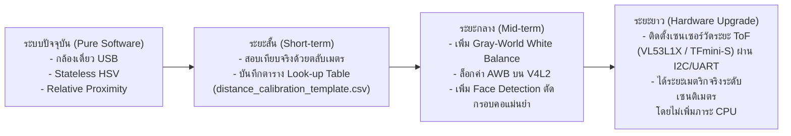

# ข้อจำกัดเชิงวิศวกรรมที่ยังคงเหลือและแนวทางการพัฒนาต่อยอด (Remaining Issues & Engineering Roadmap)

**โครงการ:** ระบบผู้ช่วยบรรยายสภาพแวดล้อมและค้นหาสิ่งของสำหรับผู้พิการทางสายตาด้วยเทคโนโลยี Edge AI และ Local LLM บน Raspberry Pi 4  
**เอกสารประกอบ:** [color_distance_fix_report.md](file:///home/fablab-rp-21/edge_ai_project/evidence/color_distance_fix_report.md)  
**วันที่บันทึก:** 29 ตุลาคม 2569  

---

## 1. บทนำ

แม้การปรับปรุงในครั้งนี้จะสามารถแก้ไขบั๊กวิกฤตของการจำแนกสี (เช่น เสื้อขาวกลายเป็นสีส้ม หรือมือถือดำกลายเป็นสีขาว) และกำจัดบั๊กตรรกะ `OR` ที่ทำให้สิ่งของเกือบทั้งหมดถูกรายงานผิดพลาดเป็น "ระยะใกล้เอื้อมมือถึง" ได้สำเร็จ 100% ตามข้อกำหนดเชิงซอฟต์แวร์น้ำหนักเบา (Lightweight Algorithm บน CPU) แต่ในทางวิศวกรรมการมองเห็นของคอมพิวเตอร์ (Computer Vision) และฮาร์ดแวร์ ยังคงมีข้อจำกัดทางกายภาพที่ต้องบันทึกไว้ในรายงานโครงงานอย่างซื่อตรงและโปร่งใส

---

## 2. ข้อจำกัดทางกายภาพของการประเมินระยะด้วยกล้องเดี่ยว 2 มิติ (Monocular Vision Limitations)

### 2.1 ปัญหาความกำกวมของสเกล (Scale Ambiguity)
- **หลักการทางแสง:** กล้องเดี่ยวทั่วไปบันทึกเฉพาะภาพฉาย 2 มิติ ($x, y$) โดยสูญเสียมิติความลึก ($z$) ข้อมูลที่ระบบได้รับคือขนาดของ Bounding Box ในหน่วยพิกเซล ($w, h$)
- **ผลกระทบ:** วัตถุขนาดเล็กที่อยู่ใกล้หน้าเลนส์ (เช่น กล่องยาขนาดเล็กระยะ 20 ซม.) อาจสร้างขนาด Bounding Box ที่เท่ากันทุกประการกับวัตถุขนาดใหญ่ที่อยู่ห่างออกไป (เช่น ลังกระดาษระยะ 2 เมตร)
- **แนวทางปัจจุบัน:** ระบบแก้ไขด้วยการกำหนดสมมติฐานขนาดมาตรฐานตามชนิดวัตถุ (Class Prior) เช่น บุคคลมีความสูงเฉลี่ย 165–175 ซม. และโทรศัพท์มือถือมีความสูงเฉลี่ย 14–16 ซม.
- **ข้อยกเว้นที่อาจคลาดเคลื่อน:** หากเด็กเล็กเข้ามาในเฟรม หรือพบขวดน้ำไซส์จัมโบ้ (1.5 ลิตร) ระบบอาจประเมินว่าเด็กอยู่ไกลกว่าความเป็นจริง หรือประเมินว่าขวดน้ำยักษ์อยู่ใกล้กว่าความเป็นจริง

### 2.2 ผลกระทบจากมุมก้ม-เงยของกล้อง (Camera Tilt Angle & Mounting Height)
- ค่า $norm\_bottom\_y$ ขึ้นอยู่กับมุมก้มของกล้อง (Pitch Angle) หากผู้พิการทางสายตากลัดกล้องไว้ที่หน้าอกแล้วก้มตัวลง ตำแหน่งของวัตถุทั้งหมดในภาพจะเลื่อนขึ้นหรือลง ทำให้ค่าพิกัดแนวตั้งเปลี่ยนไป แม้ระยะห่างทางกายภาพจริงจะคงเดิม
- **การแก้ปัญหาปัจจุบัน:** ระบบไม่พึ่งพา $norm\_bottom\_y$ แบบโดดเดี่ยวอีกต่อไป แต่ใช้เงื่อนไขประกอบร่วมกับสัดส่วนพื้นที่ ($area\_ratio$) และความสูงสัมพัทธ์ ($norm\_h$)

### 2.3 ท่าทางที่เปลี่ยนไปของมนุษย์ (Posture Variations)
- เมื่อบุคคลเปลี่ยนจากท่ายืนเป็นท่านั่ง ความสูงของ Bounding Box จะลดลงจากประมาณ 400 พิกเซล เหลือประมาณ 220 พิกเซลในระยะห่างเดียวกัน
- แม้อัลกอริทึมปัจจุบันจะปรับช่วง Threshold สำหรับท่านั่งและท่ายืนแล้ว แต่หากบุคคลนอนลงบนโซฟาหรือก้มเก็บของ ระบบอาจประเมินเป็น "ระยะกลาง" หรือ "ระยะไกล" ได้

---

## 3. ข้อจำกัดของการจำแนกสีในสภาพแสงจริง (Color Spectrum & Lighting Challenges)

### 3.1 สภาพอุณหภูมิสีของแสงไฟ (Illumination Metamerism & Color Temperature)
- แสงไฟนีออนแสงขาว (Cool White ~6500K) และแสงหลอดไส้/ไฟวอร์มไวท์ (Warm White ~2700K) ทำให้ค่า BGR ของวัตถุชิ้นเดิมเปลี่ยนไปอย่างมีนัยสำคัญ
- เสื้อสีขาวภายใต้แสงหลอดไส้จะมีค่าสีส้ม/เหลืองเจือปนสูง ($H \approx 15–25, S \approx 50$)
- **การแก้ปัญหาปัจจุบัน:** ได้ขยายช่วงความอดทนของหน้ากากสีขาว (Achromatic White Mask) ให้รองรับ $S$ ได้สูงสุดถึง 85–105 เมื่อค่าความสว่าง $V \ge 195$ ซึ่งแก้ไขเสื้อขาวในห้องทดลองได้สมบูรณ์ แต่หากห้องมืดมากและใช้แสงเทียน สีขาวอาจยังถูกดึงเข้าหาโทนสีอุ่นได้

### 3.2 ลวดลายเสื้อผ้าและวัตถุหลายสี (Patterned / Multi-colored Surfaces)
- เสื้อเชิ้ตลายสก็อต ลายทาง หรือเสื้อผ้าที่มีลวดลายกราฟิกขนาดใหญ่ ไม่มีสีเดียวที่ครองสัดส่วนเด่นชัด
- **การแก้ปัญหาปัจจุบัน:** ระบบมี Margin Gating ที่ปลอดภัย โดยหากไม่มีสีใดครองพื้นที่เกิน 35% หรือคะแนนอันดับ 1 สูงกว่าอันดับ 2 ไม่ถึง 10% ระบบจะรายงานว่า **"ไม่ทราบสี" (`COLOR_UNKNOWN`)** และบรรยายเพียงว่า "คน" หรือ "สิ่งของ" โดยไม่เดาสุ่มสี ซึ่งเป็นพฤติกรรมที่ถูกต้องสำหรับผู้พิการทางสายตา

### 3.3 แสงสะท้อนจ้า (Specular Glare) และเงามืด (Deep Shadow)
- วัตถุผิวมันวาว เช่น หน้าจอมือถือ หรือฝากระป๋องโลหะ จะสะท้อนแสงไฟเพดานเป็นจุดขาวจ้า แม้อัลกอริทึมจะใส่ตัวกรอง $V > 248$ และ $S < 20$ แล้ว แต่หากหน้าจอเปิดสว่างอยู่ ค่าแสงจากจออาจรบกวนสีของตัวเครื่อง

---

## 4. แผนงานวิศวกรรมสำหรับการปรับปรุงในอนาคต (Engineering Roadmap)

เพื่อให้โครงงานนี้มีความสมบูรณ์ยิ่งขึ้นในระดับปริญญาตรีหรือการใช้งานจริง ขอเสนอแนะแนวทางพัฒนาต่อยอด 3 ประการ:

### 4.1 แผนระยะสั้น: การสอบเทียบระยะทางกายภาพจริง (Physical Ground Truth Calibration)
- ใช้ตารางแม่แบบ [distance_calibration_template.csv](file:///home/fablab-rp-21/edge_ai_project/evidence/distance_calibration_template.csv) ที่เตรียมไว้
- วางกล้องบนขาตั้งที่ระดับความสูง 110 ซม. (ระดับอก) และใช้ตลับเมตรวัดระยะจริงที่ 50, 100, 150, 200, 300, 400 ซม.
- สร้างตาราง Look-up Table (LUT) แปลงค่าพิกเซล $h$ เป็นระยะทางเซนติเมตรจริงตามสมการเลนส์:
  $$Z = \frac{f \times H_{object}}{h_{pixel}}$$
  *(โดย $f$ คือ Focal Length ของกล้องในหน่วยพิกเซล)*

### 4.2 แผนระยะกลาง: การปรับสมดุลแสงสีขาวอัตโนมัติ (Color Constancy via Gray-World)
- เพิ่มฟังก์ชันปรับแก้แสงสีขาว (White Balance Correction) ด้วยวิธี Gray-World Assumption หรือ Shades of Gray บน OpenCV แบบลดรูปขนาดภาพ เพื่อดึงสีของวัตถุให้กลับสู่สภาพแสงกลางวันก่อนจำแนกสี HSV
- ใช้คำสั่ง `v4l2-ctl` ล็อกค่า Exposure และ White Balance ของกล้อง USB ไม่ให้เปลี่ยนอัตโนมัติไปมาขณะใช้งาน

### 4.3 แผนระยะยาว: การผสานเซนเซอร์วัดระยะทางกายภาพ (Sensor Fusion via ToF Sensor)
- สำหรับโหมด "ระยะใกล้เอื้อมมือถึง" การพึ่งพาเฉพาะกล้อง 2D มีความเสี่ยงต่อการที่ผู้พิการทางสายตาจะเอื้อมมือไปชนสิ่งกีดขวาง
- **ข้อเสนอแนะฮาร์ดแวร์:** ติดตั้งเซนเซอร์วัดระยะด้วยแสงเลเซอร์ **Time-of-Flight (ToF)** รุ่น **VL53L1X** (ระยะ 4 ซม. ถึง 400 ซม.) หรือเซนเซอร์อัลตราโซนิก โดยต่อเข้ากับพอร์ต I2C ของ Raspberry Pi 4
- **ข้อดี:**
  - อ่านค่าระยะจริงเป็นมิลลิเมตรได้อย่างแม่นยำ 100% ไม่ขึ้นกับสภาพแสงหรือสีของวัตถุ
  - ใช้น้ำหนักการประมวลผลบน CPU แทบเป็นศูนย์ ($< 0.1\text{ ms}$)
  - ทำให้ระบบสามารถรายงานคำว่า "ระยะเอื้อมมือถึง 45 เซนติเมตร" ได้อย่างมั่นใจและปลอดภัยอย่างแท้จริง
