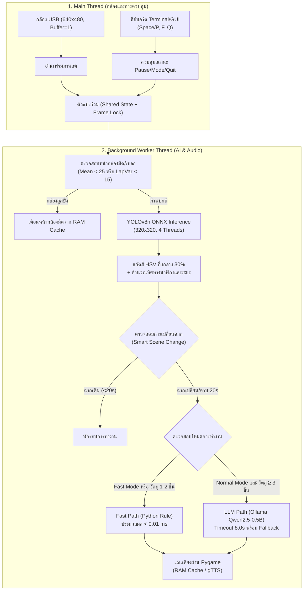

# บทที่ 3: วิธีดำเนินงานโครงงาน (Methodology)
**โครงงาน:** ระบบผู้ช่วยบรรยายสภาพแวดล้อมและค้นหาสิ่งของสำหรับผู้พิการทางสายตาด้วยเทคโนโลยี Edge AI และ Local LLM บน Raspberry Pi 4  

---

## 3.1 ภาพรวมสถาปัตยกรรมระบบ (System Architecture)

ระบบผู้ช่วยบรรยายสภาพแวดล้อมและค้นหาสิ่งของได้รับการออกแบบภายใต้สถาปัตยกรรม **Edge AI แบบไฮบริด (Hybrid Edge Computing)** เพื่อให้สามารถทำงานได้บนบอร์ดประมวลผลขนาดเล็กที่มีข้อจำกัดด้านทรัพยากร โดยแบ่งการทำงานออกเป็น 2 ส่วนหลักแบบไม่ปิดกั้นการทำงาน (Non-blocking Multi-threading Architecture) ดังนี้:

1. **เธรดหลัก (Main UI & Camera Thread):**  
   ทำหน้าที่ติดต่อกับกล้องรับภาพ USB Web Camera รับเฟรมภาพสดขนาดความละเอียด 640 × 480 พิกเซล ควบคุมการแสดงผลหน้าต่าง HUD (Head-Up Display) และคอยตรวจจับสัญญาณการกดปุ่มจากคีย์บอร์ดแบบ Non-blocking (Spacebar/P เพื่อหยุดพักชั่วคราว, F เพื่อสลับโหมด และ Q เพื่อออกจากโปรแกรม)
2. **เธรดเบื้องหลัง (Background AI Worker Thread):**  
   ทำหน้าที่ดึงเฟรมภาพล่าสุดไปผ่านขั้นตอนการประมวลผลทางคอมพิวเตอร์วิทัศน์ ตรวจจับคุณภาพภาพ (ความมืด/ความเบลอ), ประมวลผลโมเดลตรวจจับวัตถุ (YOLOv8n ONNX), จำแนกสีของวัตถุ (HSV Color Detection), วิเคราะห์ตำแหน่งเชิงพื้นที่และความสัมพันธ์กับเฟอร์นิเจอร์ (Spatial & Surface Analysis) จากนั้นตัดสินใจเลือกเส้นทางการบรรยายระหว่าง **Fast Path (Python Rule-based)** หรือ **LLM Path (Ollama Local LLM)** และขับสัญญาณเสียงแจ้งเตือนผ่านไลบรารี Pygame

---

## 3.2 ข้อมูลจำเพาะของฮาร์ดแวร์ระบบ (Hardware Specifications)

ในการดำเนินงานและทดสอบจริง ระบบทำงานบนฮาร์ดแวร์จริงซึ่งได้รับการตรวจสอบสเปกอย่างละเอียดดังนี้:

- **บอร์ดประมวลผลหลัก:** Raspberry Pi 4 Model B Revision 1.5
- **หน่วยประมวลผลกลาง (CPU):** Broadcom BCM2711, Quad-core ARM Cortex-A72 (ARMv8 64-bit) ความเร็วสัญญาณนาฬิกาสูงสุด 1.8 GHz
- **หน่วยความจำหลัก (RAM):** LPDDR4-3200 ขนาด **8.0 GB (ตรวจพบจริงในระบบ 7.63 GiB / 7,819.8 MB)**  
  *(หมายเหตุทางวิศวกรรม: อุปกรณ์ที่ใช้จริงในห้องทดลองเป็นรุ่น RAM 8 GB ไม่ใช่รุ่น 4 GB ตามข้อเสนอโครงการเดิม ซึ่งส่งผลดีต่อพื้นที่ว่างของหน่วยความจำ แต่ต้องระบุไว้อย่างชัดเจนเพื่อไม่ให้อนุมานเกินจริงไปยังรุ่น 4 GB)*
- **หน่วยความจำเสมือน (Swap):** ขนาด 2.0 GiB บน MicroSD Card
- **หน่วยบันทึกข้อมูลหลัก:** MicroSD Card ความจุ 32 GB ความเร็ว Class 10 (ระบบไฟล์ ext4)
- **อุปกรณ์รับภาพ (Vision Sensor):** กล้อง USB HD Video Camera เชื่อมต่อผ่านพอร์ต USB 3.0 เปิดใช้งานที่ความละเอียด 640 × 480 พิกเซล อัตราเฟรมฮาร์ดแวร์ 30 FPS พร้อมตั้งค่าขนาดบัฟเฟอร์ฮาร์ดแวร์เท่ากับ 1 (`cv2.CAP_PROP_BUFFERSIZE = 1`) เพื่อป้องกันความล่าช้าสะสมของเฟรมภาพ
- **อุปกรณ์ส่งออกเสียง (Audio Interface):** แจ็กเสียงอนาล็อก 3.5 มม. (Broadcom bcm2835 Headphones) และพอร์ต micro-HDMI
- **หน่วยความจำแคชความเร็วสูง (RAM Disk):** ระบบไฟล์หน่วยความจำร่วม POSIX Shared Memory (`/dev/shm/`) ขนาด 3.9 GB ใน RAM เพื่อใช้เป็นที่เก็บไฟล์เสียงระบบสำหรับเปิดเล่นทันที

---

## 3.3 ซอฟต์แวร์ ไลบรารี และสภาพแวดล้อมระบบ (Software Stack)

ระบบพัฒนาบนระบบปฏิบัติการลินุกซ์ 64 บิต โดยมีรายการซอฟต์แวร์และไลบรารีที่ใช้งานจริงดังนี้:

- **ระบบปฏิบัติการ:** Debian GNU/Linux 13 (trixie) สถาปัตยกรรม `aarch64` (Kernel: `6.18.34+rpt-rpi-v8`)
- **ภาษาโปรแกรมมิ่ง:** Python 3.13.5 (คอมไพล์ด้วย GCC 14.2.0)
- **ไลบรารีคอมพิวเตอร์วิทัศน์:** OpenCV 5.0.0 (`opencv-python`)
- **เอนจินรันไทม์ AI (Inference Runtime):** ONNX Runtime 1.31.0 กำหนด Execution Provider เป็น `CPUExecutionProvider` โดยตั้งค่าให้ทำงานแบบมัลติเธรด 4 เธรดเต็มคอร์ (`intra_op_num_threads = 4`) และเปิดการออปติไมซ์กราฟคำนวณขั้นสูงสุด (`ORT_ENABLE_ALL`)
- **เอนจิน Local LLM:** Ollama 0.40.6 ทำงานเป็น Systemd Background Service (`ollama.service`)
- **ไลบรารีเสียง:** Pygame 2.6.1 (`pygame.mixer`) สำหรับจัดการบัฟเฟอร์เสียง และ gTTS 2.5.4 สำหรับการสังเคราะห์เสียงภาษาไทยผ่านคลาวด์

---

## 3.4 แบบจำลองปัญญาประดิษฐ์และขั้นตอนวิธี (AI Models & Algorithms)

### 3.4.1 แบบจำลองการตรวจจับวัตถุ (Object Detection Model: YOLOv8n ONNX)
ระบบใช้โมเดล **YOLOv8 Nano (YOLOv8n)** ซึ่งได้รับการแปลงเป็นรูปแบบ ONNX (`yolov8n.onnx`) ขนาดไฟล์ 12.14 MB (12,725,024 ไบต์) รองรับการตรวจจับวัตถุ 80 หมวดหมู่ตาม COCO Dataset:
- **การปรับขนาดภาพ (Preprocessing):** นำภาพขนาด 640 × 480 พิกเซลมาทำ Letterbox Resizing เป็นขนาด **320 × 320 พิกเซล** โดยรักษาสัดส่วนภาพเดิมและเติมขอบด้วยสีเทา $(114, 114, 114)$ แปลงข้อมูลเป็น Tensor มิติ $[1, 3, 320, 320]$ ชนิด Float32 และปรับสเกลค่าพิกเซลให้อยู่ในช่วง $[0.0, 1.0]$
- **การถอดรหัสพิกัดและ NMS (Postprocessing):** กรองกรอบวัตถุด้วยเกณฑ์ความเชื่อมั่น `conf_thresh = 0.35` และประมวลผล Non-Maximum Suppression (NMS) ด้วยเกณฑ์ IoU `nms_thresh = 0.45` เพื่อตัดกรอบที่ซ้ำซ้อน

### 3.4.2 การจำแนกสีของวัตถุ (HSV Color Classification)
เพื่อหลีกเลี่ยงภาระการคำนวณของโครงข่ายประสาทเทียมขนาดใหญ่ ระบบใช้เทคนิคการประมวลผลภาพแบบดั้งเดิม (Classical Computer Vision):
1. คำนวณพิกัดกึ่งกลางของ Bounding Box และทำการครอปภาพเฉพาะพื้นที่ **ใจกลาง 30%** ของวัตถุ เพื่อป้องกันไม่ให้พิกเซลของพื้นหลังถูกนำมาคำนวณ
2. แปลงภาพบริเวณดังกล่าวจากระบบสี BGR เป็น **HSV (Hue, Saturation, Value)**
3. จำแนกกลุ่มสีไร้สี (Achromatic):
   - หากค่าเฉลี่ย Value $< 48.0$ กำหนดเป็น **สีดำ**
   - หากค่าเฉลี่ย Saturation $< 42.0$: ถ้า Value $> 175.0$ กำหนดเป็น **สีขาว**, มิฉะนั้นกำหนดเป็น **สีเทา**
4. จำแนกกลุ่มสีมีสี (Chromatic) จากค่ามัธยฐานของช่อง Hue ($0^\circ - 180^\circ$ ใน OpenCV):
   - $H < 10^\circ$ หรือ $H \ge 170^\circ$: **สีแดง**
   - $10^\circ \le H < 25^\circ$: **สีส้ม**
   - $25^\circ \le H < 35^\circ$: **สีเหลือง**
   - $35^\circ \le H < 85^\circ$: **สีเขียว**
   - $85^\circ \le H < 130^\circ$: **สีน้ำเงิน/ฟ้า**
   - $130^\circ \le H < 155^\circ$: **สีม่วง**
   - $155^\circ \le H < 170^\circ$: **สีชมพู**

### 3.4.3 การระบุทิศทาง ระยะห่าง และความสัมพันธ์เชิงพื้นที่ (Spatial Mapping)
- **ทิศทางตามหน้าปัดนาฬิกา (Clock-face Direction):** ใช้พิกัดกึ่งกลางแนวนอนแบบนอร์มัลไลซ์ ($cx_{\text{norm}} = \frac{cx}{W}$):
  - $cx_{\text{norm}} < 0.38$: **ทางซ้ายมือ (10 นาฬิกา)**
  - $0.38 \le cx_{\text{norm}} \le 0.62$: **ตรงหน้า (12 นาฬิกา)**
  - $cx_{\text{norm}} > 0.62$: **ทางขวามือ (2 นาฬิกา)**
- **การประมาณระดับระยะห่าง (Distance Categorization):** อาศัยพิกัดขอบล่างของวัตถุ ($y_{\text{bottom}}$) และสัดส่วนพื้นที่ Bounding Box เทียบกับหน้าจอ:
  - วัตถุขนาดเล็กบนโต๊ะ (`SMALL_TABLETOP_CLASSES` เช่น แก้วน้ำ, ขวด, มือถือ):  
    ถ้า $y_{\text{bottom}} \ge 0.55$ หรือ Area Ratio $\ge 0.035$ $\rightarrow$ **ระยะใกล้เอื้อมมือถึง**  
    ถ้า $y_{\text{bottom}} \ge 0.35$ หรือ Area Ratio $\ge 0.015$ $\rightarrow$ **ระยะกลางบนโต๊ะ/ข้างหน้า**  
    กรณีอื่น ๆ $\rightarrow$ **ระยะไกลในห้อง**
  - วัตถุขนาดใหญ่ (เช่น คน, เก้าอี้): ใช้เกณฑ์ขอบล่าง $\ge 0.72$ และ $\ge 0.45$ ตามลำดับ
- **ความสัมพันธ์กับพื้นผิว (Surface Relationships):** ตรวจสอบว่าพิกัดกึ่งกลางของวัตถุชิ้นเล็กวางอยู่ภายในขอบเขต Bounding Box ของวัตถุประเภทพื้นผิว (`dining table`, `couch`, `bed`) หรือไม่ หากเข้าเงื่อนไขจะระบุว่า "วางอยู่บนโต๊ะ", "วางอยู่บนโซฟา" เป็นต้น

### 3.4.4 กลไกการสร้างประโยคแบบไฮบริด (Hybrid Narrative Architecture)
ระบบออกแบบให้มี 2 เส้นทางการทำงานเพื่อความสมดุลระหว่างความเร็วและความเป็นธรรมชาติของภาษา:
1. **Fast Path (ระบบหาของด่วน / วัตถุ 1–2 ชิ้น):**  
   ใช้กฎภาษาไทยใน Python ประกอบโครงสร้างประโยคทันที เช่น:  
   `"ในห้องนี้แสงปกติครับ มีแก้วน้ำสีแดงวางอยู่บนโต๊ะ ทางขวามือ (2 นาฬิกา) ระยะใกล้เอื้อมมือถึงครับ"`  
   ใช้เวลาประมวลผลเพียง **~0.002 ms (2 ไมโครวินาที)** เหมาะสำหรับการแจ้งเตือนสิ่งกีดขวางแบบทันที
2. **LLM Path (ระบบบรรยายภาพรวม / วัตถุตั้งแต่ 3 ชิ้นขึ้นไป):**  
   ส่งข้อมูลวัตถุและสภาพแสงเข้าโมเดลภาษาขนาดเล็ก **Qwen2.5-0.5B** ผ่าน Ollama API ภายในเครื่อง โดยตั้งค่าพารามิเตอร์:
   - `num_ctx: 256`
   - `num_predict: 45`
   - `temperature: 0.2`
   - `num_thread: 4`
   - `keep_alive: -1`
   - **Timeout Guard:** ตั้งเวลาจำกัดการรอไว้ที่ 8.0 วินาที หากโมเดลตอบสนองช้าเกินกว่า 8.0 วินาที ระบบจะ Fallback สลับมาใช้ประโยคจาก Python ทันทีโดยผู้ใช้ไม่ต้องรอนาน

### 3.4.5 ระบบเสียงและหน่วยความจำแคชความเร็วสูง (Audio Pre-caching)
เพื่อลดความล่าช้าในการสังเคราะห์เสียง ระบบทำการสร้างไฟล์เสียงระบบที่ใช้บ่อยล่วงหน้า (Pre-cache) ในรูปไฟล์ MP3 เก็บไว้ในหน่วยความจำ RAM `/dev/shm/`:
- `cached_ready.mp3` ("เริ่มระบบพร้อมใช้งาน")
- `cached_paused.mp3` ("หยุดพักการทำงานชั่วคราว")
- `cached_resumed.mp3` ("เริ่มการทำงานต่อ")
- `cached_mode_fast.mp3` ("โหมดหาของด่วน")
- `cached_mode_normal.mp3` ("โหมดเล่าบรรยากาศ")
- `cached_camera_dark.mp3` ("หน้ากล้องมืดหรือถูกบังครับ")
- `assistant_beep.wav` (สัญญาณเสียงเตือนคลื่นไซน์ความถี่ 950 Hz สังเคราะห์ใน RAM)

สำหรับข้อความบรรยายสภาพแวดล้อมใหม่ที่ไม่มีในแคช ระบบจะเรียกใช้ Google Text-to-Speech (gTTS) ผ่านการเชื่อมต่ออินเทอร์เน็ต และบันทึกลงไฟล์ชั่วคราว `/dev/shm/tts_output.mp3` ก่อนสั่งเล่นผ่าน Pygame

---

## 3.5 ระเบียบวิธีและกระบวนการวัดผลการทดลอง (Experimental Design)

การทดลองแบ่งออกเป็น 4 ชุดการทดสอบหลักที่รันบนอุปกรณ์จริง โดยไม่มีการดัดแปลงหรือเปิดเสียงดังรบกวน:
1. **ชุดการทดสอบ Latency:** ทำการ Warm-up 5 รอบ และบันทึกเวลาจริง 30 รอบสำหรับงานคอมพิวเตอร์วิทัศน์ และ 10 รอบสำหรับงานเครือข่าย/LLM โดยใช้ฟังก์ชัน `time.perf_counter()` วัดความละเอียดระดับไมโครวินาที
2. **ชุดการประเมินคุณภาพ LLM:** ป้อนอินพุตทดสอบ 7 สถานการณ์เข้า Qwen2.5-0.5B วัดเวลา จำนวนโทเคน ความเร็ว tokens/sec และประเมินความถูกต้องตามข้อเท็จจริงเทียบกับข้อมูลอินพุต
3. **ชุดการวัดทรัพยากร (Resource Profiling):** วัดภาระ CPU รวม, การใช้ RAM, Swap, และอุณหภูมิ CPU ด้วยความถี่ 1 Hz ข้าม 4 สภาวะ (Idle 15s, YOLO Only 20s, LLM Only 25s, Complete Pipeline 30s) พร้อมกลไกตัดการทำงานอัตโนมัติหากอุณหภูมิเกิน 75°C
4. **ชุดทดสอบความทนทาน (Robustness):** ตรวจสอบการตอบสนองต่อภาพมืดสนิท, ภาพเบลอ, กรณีไม่พบวัตถุ, การจำลอง LLM Timeout, การจำลองเน็ตเวิร์กขัดข้อง, และการกดปุ่มหยุดชั่วคราว
