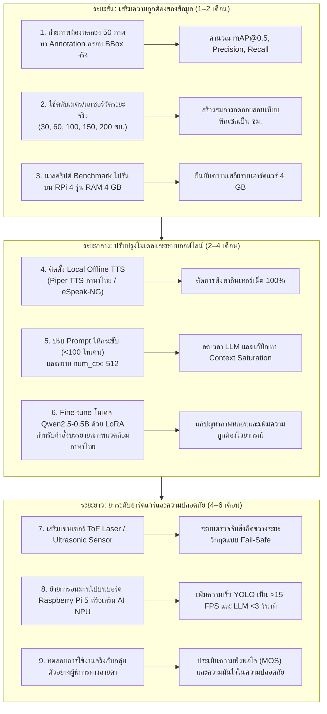

# ข้อจำกัดของโครงงานและแผนการวิจัยพัฒนาต่อยอด (Limitations and Future Work Roadmap)
**โครงงาน:** ระบบผู้ช่วยบรรยายสภาพแวดล้อมและค้นหาสิ่งของสำหรับผู้พิการทางสายตาด้วยเทคโนโลยี Edge AI และ Local LLM บน Raspberry Pi 4  
**สถานะเอกสาร:** ภาคผนวกเชิงวิศวกรรมสำหรับประกอบรายงานโครงงาน 5 บท  

---

## 1. การวิเคราะห์ข้อจำกัดของระบบปัจจุบัน (Comprehensive Limitations Analysis)

### 1.1 ข้อจำกัดด้านฮาร์ดแวร์และแพลตฟอร์ม (Hardware & Platform Constraints)
1. **การทดสอบบนบอร์ดรุ่น RAM 8 GB:**  
   การทดสอบประสิทธิภาพ การใช้หน่วยความจำ และความเสถียรทั้งหมดในโครงงานนี้ดำเนินการบน **Raspberry Pi 4 Model B Revision 1.5 รุ่น RAM 8.0 GB (7.63 GiB)** แม้ว่าผลการวัดจะแสดงให้เห็นว่าระบบใช้หน่วยความจำสูงสุดเพียงประมาณ 2,056 MB แต่ในเชิงระเบียบวิธีวิจัยทางวิศวกรรม **ไม่สามารถสรุปหรืออ้างอิงได้ว่าระบบจะทำงานได้ราบรื่นเท่ากันบนบอร์ดรุ่น RAM 4 GB** จนกว่าจะได้นำสคริปต์ Benchmark ไปรันวัดผลจริงบนบอร์ดรุ่น 4 GB
2. **การประมวลผลบน CPU โดยไม่มีตัวเร่งความเร็ว AI (No Hardware NPU):**  
   ระบบพึ่งพาพลังการประมวลผลจากคอร์ Quad-core Cortex-A72 ทั้ง 4 คอร์ของ BCM2711 เท่านั้น ไม่มีหน่วยเร่งความเร็วโครงข่ายประสาทเทียม (Neural Processing Unit: NPU) เช่น Coral Edge TPU หรือ Hailo-8L ส่งผลให้การอนุมานโมเดล YOLOv8n ใช้เวลา 187.5 ms (~5.3 FPS) และการประมวลผล Local LLM ใช้เวลาสูงถึง ~9.5 วินาที ทำให้ CPU มีภาระงานสูงถึง 96–100% ในขณะประมวลผล

---

### 1.2 ข้อจำกัดด้านชุดข้อมูลและความแม่นยำในการตรวจจับ (Dataset & Metrics Limitations)
1. **การขาดชุดข้อมูล Ground Truth Annotation บนเครื่อง:**  
   เนื่องจากในระหว่างการทดสอบบนอุปกรณ์ ไม่มีชุดภาพถ่ายที่มีการระบุพิกัดกรอบวัตถุจริง (Bounding Box Annotations) จัดเก็บอยู่บนเครื่อง จึง **ไม่สามารถคำนวณตัวชี้วัดความแม่นยำมาตรฐาน ได้แก่ Precision, Recall, F1-score และ Mean Average Precision (mAP@0.5)** ได้อย่างน่าเชื่อถือ การระบุค่าเหล่านี้เป็น `NOT MEASURED / INSUFFICIENT DATA` จึงเป็นข้อจำกัดสำคัญที่ต้องจัดทำเพิ่มเติม
2. **ขอบเขตของคลาส COCO 80 คลาส:**  
   โมเดล YOLOv8n ได้รับการฝึกสอนบน COCO Dataset ซึ่งครอบคลุมวัตถุทั่วไป 80 หมวดหมู่ แต่ยังขาดวัตถุเฉพาะทางที่จำเป็นอย่างยิ่งสำหรับผู้พิการทางสายตา เช่น ไม้เท้าขาว (White Cane), ทางม้าลาย, ทางลาดสำหรับผู้พิการ, ป้ายห้องน้ำ, หรือแผ่นกระเบื้องนำทางคนตาบอด (Braille/Tactile Paving Blocks)

---

### 1.3 ข้อจำกัดด้านการประมาณระยะห่างและความสัมพันธ์เชิงพื้นที่ (Spatial Constraints)
1. **การประมาณระยะห่างด้วยขนาดภาพ 2 มิติ (2D Pixel-based Heuristic):**  
   การจำแนกระยะห่าง "ระยะใกล้", "ระยะกลาง" และ "ระยะไกล" อาศัยเพียงความสัมพันธ์ระหว่างตำแหน่งขอบล่างของวัตถุ ($y_{\text{bottom}}$) และสัดส่วนพื้นที่ Bounding Box เทียบกับขนาดภาพเท่านั้น ยังไม่มีการสอบเทียบ (Calibration) กับระยะทางทางกายภาพจริง (Physical Ground Truth) ทำให้หากวัตถุมีขนาดจริงที่ผิดปกติ (เช่น ขวดน้ำขนาดยักษ์ หรือแก้วน้ำจำลองขนาดจิ๋ว) ระบบจะประเมินระดับระยะห่างผิดพลาดทันที

---

### 1.4 ข้อจำกัดของ Local LLM ขนาดเล็ก (LLM Architecture & Cognitive Limitations)
1. **ความจุของพารามิเตอร์ (0.5B Parameters Limit):**  
   โมเดล Qwen2.5-0.5B มีขนาดกะทัดรัด (ไฟล์ 397 MB) ทำให้สามารถโหลดค้างใน RAM ได้ แต่มีขีดจำกัดในการทำความเข้าใจคำสั่งภาษาไทยที่ซับซ้อน โดยพบพฤติกรรมภาพหลอน (Hallucination) ในสถานการณ์ S5 ซึ่งโมเดลลอกข้อความ Few-shot ใน Prompt มาตอบแทนข้อมูลภาพจริง
2. **ปัญหา Context Window Saturation และความเร็วในการประมวลผล:**  
   Prompt ภาษาไทยของระบบมีขนาดถึง 252 โทเคน ซึ่งกินพื้นที่ 98.4% ของ Context Window (`num_ctx: 256`) ส่งผลให้เกิดการสลับหน่วยความจำบริบท (Slot Context Shift) ประกอบกับความเร็วในการสร้างข้อความบน CPU อยู่ที่ประมาณ 7.3–10.9 tokens/sec ทำให้เวลาตอบสนองโดยเฉลี่ยอยู่ที่ 9.5 วินาที ซึ่งเกินกว่าเกณฑ์ Timeout 8.0 วินาทีของระบบหลัก

---

### 1.5 ข้อจำกัดด้านระบบเสียงและการเชื่อมต่อเครือข่าย (Audio & Network Constraints)
1. **การพึ่งพาอินเทอร์เน็ตของระบบสังเคราะห์เสียง (Cloud TTS Dependency):**  
   ระบบ Text-to-Speech ปัจจุบันใช้ gTTS ซึ่งต้องเชื่อมต่อกับ Google TTS Server ผ่านอินเทอร์เน็ต (ความหน่วงเฉลี่ย ~370 ms) หากระบบถูกนำไปใช้งานในจุดอับสัญญาณเครือข่าย ระบบจะไม่สามารถสร้างเสียงพูดประโยคใหม่ได้ และจะทำได้เพียงเล่นไฟล์เสียงที่แคชไว้ใน RAM เท่านั้น
2. **ขอบเขตการวัดเวลาเสียงระดับซอฟต์แวร์ (Software-Level Latency Boundary):**  
   เวลาการจัดการเสียงทั้งหมดที่บันทึกในการทดลองเป็นเวลาของซอฟต์แวร์บัฟเฟอร์ในระบบปฏิบัติการเท่านั้น ไม่ได้รวมความหน่วงของวงจรขับเสียง DAC, วงจรขยายเสียง หรือเวลาเดินทางของคลื่นเสียงในอากาศ

---

### 1.6 ข้อจำกัดด้านความปลอดภัยในการนำทางจริง (Critical Operational Safety Warning)
> [!CAUTION]
> **คำเตือนด้านความปลอดภัยในการนำทาง:**  
> **ระบบนี้ยังไม่ได้รับการรับรองว่ามีความปลอดภัยเพียงพอสำหรับการนำทางผู้พิการทางสายตาในชีวิตประจำวัน** เนื่องจากระบบยังไม่ผ่านการทดสอบกับวัตถุเคลื่อนไหวเร็ว (เช่น รถยนต์ หรือสัตว์เลี้ยง) และยังไม่มีเซนเซอร์วัดระยะทางเชิงกายภาพที่ป้องกันความผิดพลาด (Fail-Safe Distance Sensors) ห้ามนำระบบไปใช้งานในสภาพแวดล้อมจริงโดยปราศจากผู้ช่วยนำทางที่เป็นมนุษย์

---

## 2. แผนที่การพัฒนาและปรับปรุงระบบในอนาคต (Future Work Roadmap)

เพื่อให้โครงงานนี้มีความสมบูรณ์เชิงวิศวกรรมและสามารถนำไปต่อยอดได้จริง จึงกำหนดแผนงานพัฒนาเป็นขั้นตอนดังนี้:

---

## 3. ขั้นตอนการเก็บข้อมูล Ground Truth เพิ่มเติมสำหรับบทที่ 4 (Actionable Data Collection Protocol)

สำหรับนักศึกษาที่ต้องการเก็บข้อมูลเพิ่มเติมเพื่อนำมาคำนวณ mAP ให้ครบถ้วนสมบูรณ์ สามารถปฏิบัติตามแนวทางปฏิบัตินี้ได้ทันที:

1. **การถ่ายภาพชุดข้อมูลทดสอบ (Test Dataset Collection):**  
   ใช้กล้อง USB ตัวเดียวกับที่ติดตั้งบนระบบ ถ่ายภาพสิ่งของเครื่องใช้บนโต๊ะและในห้องเรียน/ห้องทดลองจำนวน **50 ภาพ** โดยกระจายสภาพแสง 3 รูปแบบ (แสงธรรมชาติช่วงกลางวัน 20 ภาพ, แสงหลอดไฟนีออน 20 ภาพ, และสภาพแสงน้อย/ปิดไฟบางดวง 10 ภาพ) และจัดวางสิ่งของในมุมมอง 10, 12, 2 นาฬิกา ที่ระยะใกล้ กลาง ไกล
2. **การทำ Bounding Box Annotation:**  
   นำภาพถ่ายทั้ง 50 ภาพไปติดป้ายกำกับด้วยโปรแกรม LabelImg หรือ Roboflow โดยระบุคลาส COCO ที่ตรงกัน (เช่น `cup`, `bottle`, `cell phone`, `laptop`, `chair`, `dining table`) และส่งออกข้อมูลเป็นไฟล์ข้อความ `.txt` รูปแบบ YOLO Format (Normalized $[class, cx, cy, w, h]$)
3. **การคำนวณค่า mAP@0.5 ด้วย Python:**  
   สร้างสคริปต์คำนวณ IoU จับคู่ผลการทำนายจาก `yolov8n.onnx` เทียบกับไฟล์ Annotation เพื่อคำนวณสถิติ:
   - $\text{Precision} = \frac{TP}{TP + FP}$
   - $\text{Recall} = \frac{TP}{TP + FN}$
   - $\text{F1-score} = 2 \times \frac{\text{Precision} \times \text{Recall}}{\text{Precision} + \text{Recall}}$
   - $\text{mAP@0.5}$ (Mean Average Precision ที่เกณฑ์ IoU $\ge 0.5$)
4. **การสอบเทียบระยะทางทางกายภาพ (Distance Calibration):**  
   วางวัตถุมาตรฐาน (เช่น แก้วน้ำทรงกระบอกขนาดเส้นผ่านศูนย์กลาง 8 ซม. สูง 12 ซม.) ที่ระยะห่างจริงจากหน้ากล้อง 30, 50, 70, 100, 150, และ 200 เซนติเมตร โดยใช้ตลับเมตรวัด บันทึกค่าพิกัด $y_{\text{bottom}}$ และค่าความสูงของ Bounding Box ในภาพ แล้วนำมาสร้างกราฟความสัมพันธ์เพื่อกำหนดค่า Threshold เชิงกายภาพที่แท้จริง
