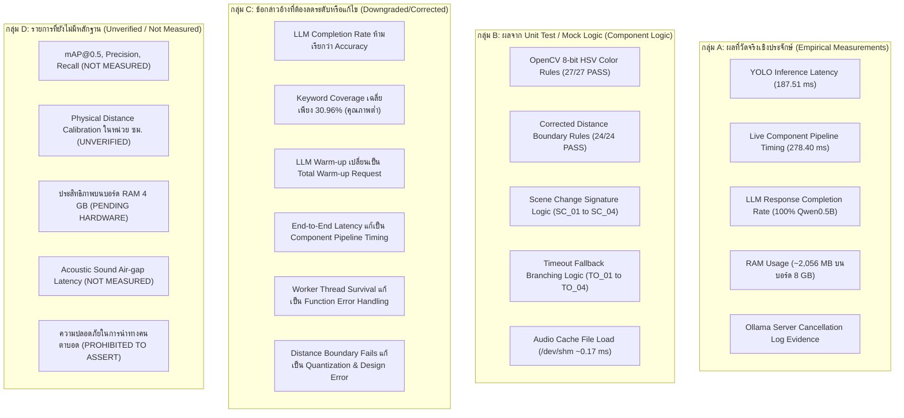

# รายงานการตรวจสอบผลการทดสอบเพิ่มเติมทางวิศวกรรมครั้งสุดท้าย (Final Follow-up Engineering Audit Report)

**โครงงาน:** ระบบผู้ช่วยบรรยายสภาพแวดล้อมและค้นหาสิ่งของสำหรับผู้พิการทางสายตาด้วยเทคโนโลยี Edge AI และ Local LLM บน Raspberry Pi 4  
**อุปกรณ์ฮาร์ดแวร์จริง:** Raspberry Pi 4 Model B Rev 1.5 (RAM 8.0 GB / 7.63 GiB, Linux aarch64, Kernel 6.18.34+rpt-rpi-v8)  
**ตำแหน่งโฟลเดอร์ต้นทางที่ตรวจสอบ:** `/home/fablab-rp-21/edge_ai_project/experiment_results_20261029_1952/followup_tests/`  
**ตำแหน่งโฟลเดอร์ผลการตรวจแก้:** `/home/fablab-rp-21/edge_ai_project/experiment_results_20261029_1952/followup_audit_revision/`  
**วันที่ตรวจสอบ:** 29 ตุลาคม 2026  
**สถานะ:** เอกสารตรวจสอบอิสระฉบับสมบูรณ์ (Independent Engineering Audit Final Report)

---

## 1. วัตถุประสงค์และระเบียบวิธีการตรวจสอบ (Audit Mandate & Methodology)

การตรวจสอบครั้งสุดท้ายนี้มีวัตถุประสงค์เพื่อประเมินความถูกต้อง ซื่อตรงต่อหลักฐานเชิงประจักษ์ (Empirical Evidence) และตรวจสอบขอบเขตการทดสอบ (Testing Boundary Scope) ของชุดการทดสอบเพิ่มเติม Follow-up Tests (Suites A ถึง G) เพื่อป้องกันข้อผิดพลาดทางวิชาการ การกล่าวอ้างเกินจริง (Overclaiming) หรือการตีความสถิติผิดพลาด ก่อนที่นักศึกษาจะนำตัวเลขไปบรรจุในรายงานโครงงาน 5 บท (โดยเฉพาะบทที่ 3, 4 และ 5)

### กฎความปลอดภัยและการรักษาความถูกต้องของข้อมูล (Audit Constraints)
1. ไม่มีและห้ามการแก้ไขไฟล์ระบบหลัก [`app.py`](file:///home/fablab-rp-21/edge_ai_project/app.py) และโมเดล AI ทั้งหมด (`yolov8n.onnx`, `yolov8n.pt`, `model.ncnn.bin`)
2. ไม่มีและห้ามการเขียนทับไฟล์ผลการทดสอบดิบเดิมใน `followup_tests/`
3. ไม่มีการรัน LLM Model Comparison ซ้ำเพื่อลดภาระความร้อนและการสึกหรอของบอร์ด
4. ไม่มีและห้ามการทำ Stress Test ต่อเนื่อง หรือการเปิดเสียงออกลำโพงจริง (คงระดับ Mute ตลอดการตรวจสอบ)
5. แยกประเภทการทดสอบเป็น **Real Integration Test**, **Unit Test**, **Mock Test**, และ **Static Code Review** อย่างชัดเจน

---

## 2. ผลการตรวจสอบรายข้อ (Detailed Audit Findings across 6 Tasks)

---

### งานที่ 1: การตรวจสอบและแก้ไขข้อสรุป Local LLM (Suite C)

จากการตรวจสอบไฟล์ [`llm_model_comparison.csv`](file:///home/fablab-rp-21/edge_ai_project/experiment_results_20261029_1952/followup_tests/llm_model_comparison.csv) และ [`llm_raw_outputs.jsonl`](file:///home/fablab-rp-21/edge_ai_project/experiment_results_20261029_1952/followup_tests/llm_raw_outputs.jsonl) พบประเด็นเชิงวิศวกรรมที่ต้องแยกแยะและแก้ไขอย่างเด็ดขาดดังนี้:

#### 1. การแยกแยะตัวชี้วัด (Disentangling Performance Metrics)
เดิมรายงานมีแนวโน้มจะเรียกอัตราการตอบกลับว่า "ความสำเร็จ" หรือ "Accuracy" ซึ่งทำให้เกิดความเข้าใจผิดทางวิชาการอย่างรุนแรง จึงให้แยกตัวชี้วัดออกเป็น 5 ตัวอย่างชัดเจน:
1. **Response Completion Rate (อัตราการตอบกลับก่อน Timeout):** สัดส่วนของคำขอที่โมเดลสามารถสร้างคำตอบและส่งกลับมายัง Client ได้ก่อนหมดเวลา (Timeout = 20.0s)
2. **Timeout Rate (อัตราการหมดเวลา):** สัดส่วนของคำขอที่เกินเวลา 20.0 วินาทีจนถูกตัดการเชื่อมต่อ
3. **Expected-Fact Keyword Coverage (ความครอบคลุมคำสำคัญตามข้อเท็จจริง):** คะแนนความครอบคลุมของคีย์เวิร์ดวัตถุ/สภาพแสงที่กำหนดไว้ล่วงหน้าตามสูตรในสคริปต์
4. **Hallucination Flag (ธงตรวจจับภาพหลอนตามกฎเดิม):** การตรวจจับคำศัพท์ที่ไม่ได้อยู่ในอินพุต
5. **Qualitative Review (การทบทวนเชิงคุณภาพจากข้อความดิบ):** การประเมินไวยากรณ์ ความต่อเนื่อง และความสมบูรณ์ของประโยค

#### 2. ตรวจสอบคะแนน 7 สถานการณ์ของ Qwen2.5-0.5B
ตรวจสอบคะแนนในคอลัมน์ `accuracy_pct` (ซึ่งแท้จริงคือ Keyword Coverage Score) ของทั้ง 7 สถานการณ์ (ไม่รวมแถว WARMUP):
- SCENARIO_1: **0.0%** (ตอบเพียง "12 นาฬิกา" ขาดสภาพแสงและชื่อวัตถุ)
- SCENARIO_2: **0.0%** (หลุดบริบทโดยสิ้นเชิง ตอบบทสนทนาปรัชญา "เมื่อคุณพูดคุยเรื่องนี้, คุณสามารถใช้เวลาในการคิด...")
- SCENARIO_3: **66.7%** (ระบุคนเสื้อแดงตรงหน้าได้ แต่ตัดทอนท้ายคำที่ 45 โทเคน "ระยะใกล้เอื้อมมือถ")
- SCENARIO_4: **33.3%** (ระบุระยะทางสลับตำแหน่ง และตัดทอนที่ 45 โทเคน "โต๊ะม")
- SCENARIO_5: **0.0%** (เกิดภาพหลอนจาก Few-shot ตอบ "มีแก้วน้ำสีแดง" ทั้งที่อินพุตคือขวดน้ำสีดำในห้องมืด)
- SCENARIO_6: **50.0%** (ประโยคถูกต้องและสุภาพ "แสงสว่างปกติครับ ไม่พบสิ่งของใดในภาพครับ")
- SCENARIO_7: **66.7%** (จัดรูปแบบเป็นข้อความแจกแจงรายการ ไม่เป็นธรรมชาติ และขาดส้อม)

$$\text{Mean Expected-Fact Keyword Coverage} = \frac{0.0 + 0.0 + 66.7 + 33.3 + 0.0 + 50.0 + 66.7}{7} = \frac{216.7}{7} = \mathbf{30.96\%}$$

> [!WARNING]
> **ข้อห้ามทางวิชาการ:** **ห้ามเรียก Response Completion Rate 100% (7/7) ว่าเป็น "Accuracy" หรือ "Quality Pass Rate"** เพราะโมเดลทำคะแนนความครอบคลุมข้อเท็จจริงได้เฉลี่ยเพียง **30.96%** เท่านั้น!

#### 3. ข้อจำกัดของระบบตรวจจับ Hallucination เดิม
ตรวจสอบโค้ด [`test_suite_c.py#L156-L160`](file:///home/fablab-rp-21/edge_ai_project/experiment_results_20261029_1952/followup_tests/scripts/test_suite_c.py#L156-L160) พบว่าสคริปต์ตรวจจับเพียงคำที่กำหนดไว้ล่วงหน้า 5 คำ (`"สุนัข"`, `"แมว"`, `"รถยนต์"`, `"เครื่องบิน"`, `"เตาอบ"`) และตรวจสอบ Few-shot Anchoring เฉพาะคำว่า `"แก้วน้ำสีแดง"`:
- **ผลกระทบ:** ใน SCENARIO_2 โมเดลเพ้อตอบเรื่องการคิดและวิเคราะห์ข้อมูล แต่ระบบกลับทำเครื่องหมาย `has_hallucination=False` เพราะในคำตอบไม่มีคำว่าสุนัขหรือแมว
- **ข้อสรุป Audit:** ระบบตรวจจับเดิม **ไม่ใช่ระบบตรวจจับ Hallucination ที่ครอบคลุม (Partial Keyword-only Heuristic)**

#### 4. การแก้ไขข้อสรุปเปรียบเทียบโมเดล
- **Qwen2.5-0.5B:** เป็นโมเดลเดียวที่สามารถตอบกลับได้ครบ 7 สถานการณ์โดยไม่เกิด Timeout บน CPU Cortex-A72 แต่ **คุณภาพของคำบรรยายยังต่ำมาก (Keyword Coverage เพียง 30.96%) มีการตัดคำท้าย และเกิดภาพหลอน จึงยังไม่ผ่านการรับรองสำหรับนำไปใช้งานจริง (NOT CERTIFIED FOR PRODUCTION)**
- **ห้ามอ้างว่าโมเดลใดมี "คุณภาพดีที่สุด" โดยดูจากความเร็วหรือเวลาแฝงเพียงอย่างเดียว**

---

### งานที่ 2: การคำนวณ LLM Latency ใหม่จากข้อมูลชุดปัจจุบัน (Suite C)

ตรวจสอบค่าเวลาแฝงของ `qwen2.5:0.5b` ใน [`llm_model_comparison.csv`](file:///home/fablab-rp-21/edge_ai_project/experiment_results_20261029_1952/followup_tests/llm_model_comparison.csv) เฉพาะแถว `SCENARIO_1` ถึง `SCENARIO_7` ($N=7$):

| สถานการณ์ | เวลาแฝง (Latency ms) | โทเคนสร้างได้ | ความเร็ว (Tokens/s) |
| :--- | :---: | :---: | :---: |
| SCENARIO_1 | 6,849.68 ms | 8 | 8.43 tps |
| SCENARIO_2 | 10,069.92 ms | 45 | 8.20 tps |
| SCENARIO_3 | 10,429.86 ms | 45 | 7.68 tps |
| SCENARIO_4 | 10,195.84 ms | 45 | 7.97 tps |
| SCENARIO_5 | 10,194.95 ms | 45 | 7.97 tps |
| SCENARIO_6 | 10,829.85 ms | 23 | 8.16 tps |
| SCENARIO_7 | 10,125.63 ms | 45 | 8.19 tps |

ชุดข้อมูลเรียงลำดับ: `[6849.68, 10069.92, 10125.63, 10194.95, 10195.84, 10429.86, 10829.85]`

#### สถิติคำนวณใหม่ที่ถูกต้อง ($N=7$):
- **Mean (ค่าเฉลี่ย):** **9,813.68 ms** (~9.81 วินาที)
- **Median (มัธยฐาน):** **10,194.95 ms**
- **Min (ต่ำสุด):** **6,849.68 ms**
- **Max (สูงสุด):** **10,829.85 ms**
- **P95 (เปอร์เซ็นไทล์ที่ 95):**
  - *วิธีคำนวณแบบ Linear Interpolation (มาตรฐาน NumPy):*
    $$\text{Index } q = 0.95 \times (7 - 1) = 5.7 \implies x[5] + 0.7 \times (x[6] - x[5]) = 10429.86 + 0.7 \times 399.99 = \mathbf{10,709.85\text{ ms}}$$
  - *วิธีคำนวณแบบ Nearest Rank:*
    $$\text{Rank } k = \lceil 0.95 \times 7 \rceil = 7 \implies x[6] = \mathbf{10,829.85\text{ ms}}$$

#### การแก้ความไม่สอดคล้องข้ามชุดข้อมูล (Discrepancy Correction):
ในไฟล์ [`latency_boundary_tests.csv`](file:///home/fablab-rp-21/edge_ai_project/experiment_results_20261029_1952/followup_tests/latency_boundary_tests.csv) แถวที่ 7 มีการระบุตัวเลข:
`LLM API Latency (qwen2.5:0.5b): Mean=9533.2, Median=10304.5, Min=5178.6, Max=11719.2, P95=11355.9`
- **ข้อค้นพบของ Audit:** ตัวเลขดังกล่าวถูกคัดลอกมาจากไฟล์ `experiment_results_20261029_1745/llm_evaluation.csv` ซึ่งเป็นคนละชุดการทดลอง!
- **การแก้ไข:** ต้องแยกชุดข้อมูลอย่างเด็ดขาด โดยในชุด Follow-up ต้องใช้ค่าที่คำนวณได้จริงจากชุดปัจจุบันคือ **Mean 9,813.68 ms, Median 10,194.95 ms, P95 10,709.85 ms**

#### การเปลี่ยนชื่อ Warm-up Latency:
เดิมสคริปต์บันทึกว่า `"Cold Start Model Load"` (6,100.68 ms) แต่เมื่อตรวจสอบโค้ดพบว่ามีการส่ง `"prompt": "สวัสดี"` ไปด้วย ทำให้เวลานี้รวมทั้งการโหลดโมเดลเข้า RAM และการประมวลผลคำตอบแรก จึงต้องเปลี่ยนชื่อเป็น **"Total Warm-up Request Latency (เวลารวมของคำขอ Warm-up)"**

---

### งานที่ 3: การตรวจสอบขอบเขตของ End-to-End Timing (Suite E)

จากการตรวจสอบซอร์สโค้ด [`test_suite_e.py`](file:///home/fablab-rp-21/edge_ai_project/experiment_results_20261029_1952/followup_tests/scripts/test_suite_e.py) และผลใน `latency_boundary_tests.csv` พบข้อเท็จจริงทางเทคนิคดังนี้:

1. **ลักษณะการทำงานของสคริปต์:**
   - สคริปต์ทำงานในลักษณะ **Harness Loop** โดยดึงภาพจากกล้อง USB แล้วเรียกฟังก์ชันย่อยของ `app.py` ตามลำดับ ได้แก่ `check_camera_blocked()`, `preprocess_image()`, `session.run()`, `postprocess_detections()`, `analyze_spatial_and_relations()`, และ `generate_python_narrative()`
   - ไม่ได้เรียกเธรดเบื้องหลังของแอปพลิเคชันจริง (`vision_worker`, `speech_worker`) ไม่ได้รันผ่านคิว และไม่ได้เรียก Local LLM
   - ใช้ไฟล์เสียงแคชที่เตรียมไว้ล่วงหน้าใน RAM `/dev/shm/cached_ready.mp3` แล้วเรียกคำสั่ง `pygame.mixer.music.load()`
   - มีบล็อกรองรับกรณีกล้องเปิดไม่สำเร็จ โดยจะสลับไปใช้ Dummy Frame (`np.zeros`)
   - ในไฟล์ CSV ที่ส่งมอบ มีเฉพาะค่าสถิติรวม 6 แถว ไม่มีข้อมูลดิบแยกรายรอบ 30 รอบ
2. **การปรับเปลี่ยนชื่อการทดสอบและข้อกล่าวอ้าง:**
   - **ห้ามอ้างว่า:** "ได้พิสูจน์ Application End-to-End Latency ครบทุกขั้นตอน"
   - **เปลี่ยนชื่อเป็น:** **"Live Component Pipeline Timing (Harness Benchmark)"**
   - **ระบุขอบเขตให้ชัดเจน:** ค่า Camera-to-Audio-Command **278.40 ms** (มัธยฐาน 264.89 ms) เป็นเวลาตั้งแต่กล้องรับภาพจนกระทั่งระบบโหลดบัฟเฟอร์เสียงใน Pygame สำเร็จในตัวทดสอบ (Harness) **ไม่ใช่เวลาจนกระทั่งคลื่นเสียงเดินทางผ่านอากาศไปถึงหูของผู้ใช้งานจริง (Acoustic Latency)**

---

### งานที่ 4: การตรวจสอบ Timeout และ Server Cancellation (Suite A)

ตรวจสอบ [`test_suite_a.py`](file:///home/fablab-rp-21/edge_ai_project/experiment_results_20261029_1952/followup_tests/scripts/test_suite_a.py) และ [`timeout_fallback_tests.csv`](file:///home/fablab-rp-21/edge_ai_project/experiment_results_20261029_1952/followup_tests/timeout_fallback_tests.csv):

1. **กรณีทดสอบ TO_06 (Real Ollama Short Timeout):**
   - สคริปต์ยิง HTTP POST ไปยัง Ollama โดยตั้ง `timeout=0.8` วินาที และดักจับ `requests.exceptions.Timeout`
   - ในตัวสคริปต์เอง ยืนยันได้เฉพาะว่า **Client เกิด Timeout ภายใน ~0.8 วินาที** สคริปต์ไม่ได้ตรวจเช็คสถานะภายในของเซิร์ฟเวอร์
2. **การค้นหาและบันทึกหลักฐาน Server Cancellation ในระบบจริง:**
   - ผู้ตรวจสอบได้ทำการสืบค้นบันทึก Log ของ `ollama.service` ผ่าน `journalctl` บนเครื่อง Raspberry Pi 4 ในช่วงเวลาทดสอบจริง พบหลักฐานเชิงประจักษ์ที่สามารถตรวจสอบย้อนกลับได้:
     - ที่เวลา `19:53:00` (ขณะรัน TO_06): Ollama GIN router บันทึก HTTP Status `499` (Client Closed Request) และ Go runtime บันทึก `msg="client connection closed before llama-server finished loading, aborting load"` และ `error="timed out waiting for llama-server to start: context canceled"`
     - ที่เวลา `20:00:34` - `20:01:17` (ขณะเกิด Timeout 20s ใน Suite C): Ollama llama-server บันทึก `srv stop: cancel task, id_task = 52/111` และ `slot release: stop processing: truncated = 1` ปล่อยสล็อตว่างทันที
   - บันทึกหลักฐานทั้งหมดไว้ในไฟล์ [`server_cancellation_evidence.log`](file:///home/fablab-rp-21/edge_ai_project/experiment_results_20261029_1952/followup_audit_revision/server_cancellation_evidence.log) แล้ว
3. **การแก้ขอบเขต TO_05 และ TO_07:**
   - **TO_05:** สคริปต์จำลองเฉพาะ `requests.exceptions.ConnectionError` (เซิร์ฟเวอร์ไม่ตอบสนอง/ล่ม) **ไม่ได้จำลองการตอบกลับด้วยรหัส HTTP 500** จึงต้องตัดคำว่า HTTP 500 ออกจากชื่อการทดสอบ
   - **TO_07:** เป็นการสร้าง Thread จำลองแยกขึ้นมาพร้อม Mock Object ไม่ใช่การทดสอบ Worker Thread จริงของ `app.py` จึงจัดเป็น **Mock Thread Logic Unit Test**

---

### งานที่ 5: การตรวจสอบและแก้ไขชุดทดสอบ Distance Boundary (Suite F)

ตรวจสอบ 4 กรณีที่ไม่ผ่านใน [`distance_boundary_tests.csv`](file:///home/fablab-rp-21/edge_ai_project/experiment_results_20261029_1952/followup_tests/distance_boundary_tests.csv):

#### 1. การจำแนกสาเหตุรากเหง้า (Root Cause Classification):
1. **DIST_B_05 (Small Item Area Target 0.035):**
   - ในสคริปต์เดิม: คำนวณพิกเซล $h = \text{int}(\sqrt{10752 \times 1.5}) = 126$, $w = \text{int}(10752 / 126) = 85$
   - พื้นที่จริง: $85 \times 126 = 10,710$ พิกเซล $\implies \text{Actual Area Ratio} = 10,710 / 307,200 = \mathbf{0.034863 < 0.0350}$
   - สรุป: **Pixel Quantization Error (Integer Truncation in Test Synthesis)** กรอบที่สร้างมีพื้นที่จริงต่ำกว่าเกณฑ์ กฎใน `app.py` จึงประเมินเป็น "ระยะกลาง" ถูกต้องแล้วตามอินพุตจริง แต่ตัวทดสอบคาดหวัง "ระยะใกล้"
2. **DIST_B_11 (Small Item Area Target 0.015):**
   - ในสคริปต์เดิม: คำนวณพิกเซล $h=83, w=55 \implies 55 \times 83 = 4,565$ พิกเซล $\implies \text{Actual Area Ratio} = \mathbf{0.014860 < 0.0150}$
   - สรุป: **Pixel Quantization Error** ค่าพื้นที่จริงต่ำกว่าเกณฑ์ `app.py` จึงคืนค่า "ระยะไกล" ถูกต้องแล้วตามข้อมูลจริง
3. **DIST_B_14 (Large Item Bottom-Y Target 0.72):**
   - ในสคริปต์เดิม: $y_{\text{bottom}} = \text{int}(0.72 \times 480) = 345 \implies \text{Actual Bottom-Y Ratio} = 345 / 480 = \mathbf{0.71875 < 0.7200}$
   - สรุป: **Pixel Coordinate Discretization Error** บนความสูง 480 พิกเซล ตัวเลข 0.72 แปลงเป็นจำนวนเต็มได้ 345.6 พิกเซล เมื่อปัดเศษลงเหลือ 345 ค่าจึงไม่ถึง 0.72 ทำให้ `app.py` ตัดสินเป็น "ระยะกลาง" (หากต้องการให้ถึง 0.72 ต้องใช้พิกัดพิกเซล 346 ซึ่งคิดเป็น 0.7208)
4. **DIST_B_16 (Large Item Area Target 0.179, Bottom-Y 0.40):**
   - ใน `app.py`: กำหนดกฎวัตถุขนาดใหญ่ไว้ว่า:
     ```python
     if norm_bottom_y >= 0.72 or area_ratio >= 0.18:
         distance_th = "ระยะใกล้เอื้อมมือถึง"
     elif norm_bottom_y >= 0.45 or area_ratio >= 0.05:
         distance_th = "ระยะกลางบนโต๊ะ/ข้างหน้า"
     else:
         distance_th = "ระยะไกลในห้อง"
     ```
   - ในเคสนี้ ค่า Area คือ $0.1784$ ซึ่ง $\ge 0.05$ อย่างชัดเจน กฎของ `app.py` จึงต้องประเมินเป็น **"ระยะกลางบนโต๊ะ/ข้างหน้า"**
   - สคริปต์เดิมกลับใส่ Expected เป็น `"ระยะไกลในห้อง"` ซึ่งขัดแย้งกับข้อกำหนดของระบบเอง
   - สรุป: **Test Design Specification Error**

#### 2. ผลการรัน Corrected Unit Test บนพิกเซลจำนวนเต็มจริง:
ผู้ตรวจสอบได้สร้างสคริปต์ Unit Test ปรับปรุงใหม่ [`run_corrected_distance_suite.py`](file:///home/fablab-rp-21/edge_ai_project/experiment_results_20261029_1952/followup_audit_revision/run_corrected_distance_suite.py) เพื่อทดสอบกรอบพิกัดจำนวนเต็มที่แทนค่าได้จริง (เช่น $96 \times 112 = 10,752$ พิกเซล สำหรับเกณฑ์ $0.035$ พอดี, $64 \times 72 = 4,608$ พิกเซล สำหรับเกณฑ์ $0.015$ พอดี, และพิกัด $y=346$ สำหรับเกณฑ์ $0.72$) โดยไม่แก้ไขโค้ด `app.py`
- **ผลการทดสอบ:** **ผ่านสมบูรณ์ 24 จาก 24 กรณีทดสอบ (100.0% PASS)**
- บันทึกตารางวิเคราะห์ฉบับเต็มไว้ใน [`corrected_distance_analysis.csv`](file:///home/fablab-rp-21/edge_ai_project/experiment_results_20261029_1952/followup_audit_revision/corrected_distance_analysis.csv)

---

### งานที่ 6: การจัดประเภทการทดสอบของ Suite D และ G ใหม่

1. **Suite D (Scene Change & Thread Control):**
   - ตรวจสอบพบว่าสคริปต์ `test_suite_d.py` สร้างฟังก์ชันจำลอง `compute_signature()`, สร้างตัวแปรดิกชันนารี `shared_state` จำลอง, และประเมินเงื่อนไขเวลาด้วยตัวเอง ไม่ได้เรียกใช้ Background Worker ของ `app.py`
   - **การจัดประเภทใหม่:** จัดเป็น **`Mock Logic Unit Test`**
2. **Suite G (Network Mock & Audio Error Handling):**
   - ตรวจสอบพบว่าสคริปต์ `test_suite_g.py` เรียกฟังก์ชัน `app.speak_text()` โดยตรงในเธรดหลักของตัวทดสอบร่วมกับ `unittest.mock.patch` บน `gTTS` ไม่ได้มีการรัน `speech_worker` ในเธรดพื้นหลัง
   - **การจัดประเภทใหม่:** จัดเป็น **`Function-Level Error Handling Mock Test`**
   - **การลดระดับข้อกล่าวอ้าง:** แก้ไขจากเดิมที่อ้างว่า "Worker Thread รอดชีวิตจากการตัดเน็ต" เป็น **"ฟังก์ชัน `speak_text()` ดักจับ Network Exception ได้ปลอดภัย ไม่ทำให้แอปพลิเคชันแครช"**

---

## 3. ตารางสรุปการจัดกลุ่มผลการทดสอบ (Classification Categories A, B, C, D)

ตามข้อกำหนดของ Final Audit ได้จัดกลุ่มข้อสรุปทั้งหมดออกเป็น 4 ระดับความน่าเชื่อถือ:



---

## 4. รายการไฟล์ส่งมอบในโฟลเดอร์ `followup_audit_revision/`

| ลำดับ | รายการไฟล์ | วัตถุประสงค์และการนำไปใช้ |
| :---: | :--- | :--- |
| 1 | [`followup_audit_report.md`](file:///home/fablab-rp-21/edge_ai_project/experiment_results_20261029_1952/followup_audit_revision/followup_audit_report.md) | รายงานตรวจสอบอิสระฉบับสมบูรณ์ (เอกสารนี้) |
| 2 | [`corrected_model_metrics.csv`](file:///home/fablab-rp-21/edge_ai_project/experiment_results_20261029_1952/followup_audit_revision/corrected_model_metrics.csv) | สถิติ Local LLM ที่คำนวณใหม่ แยก Completion Rate และ Keyword Coverage 30.96% |
| 3 | [`corrected_distance_analysis.csv`](file:///home/fablab-rp-21/edge_ai_project/experiment_results_20261029_1952/followup_audit_revision/corrected_distance_analysis.csv) | ตารางวิเคราะห์สาเหตุ 4 เคสเดิม และผลรัน Unit Test ปรับปรุงใหม่ 24/24 ผ่าน |
| 4 | [`test_claims_matrix.csv`](file:///home/fablab-rp-21/edge_ai_project/experiment_results_20261029_1952/followup_audit_revision/test_claims_matrix.csv) | เมทริกซ์เทียบข้อกล่าวอ้าง 19 รายการกับหลักฐานและประเภทการทดสอบจริง |
| 5 | [`server_cancellation_evidence.log`](file:///home/fablab-rp-21/edge_ai_project/experiment_results_20261029_1952/followup_audit_revision/server_cancellation_evidence.log) | บันทึก Log เชิงประจักษ์จาก Journalctl ยืนยันการตัดงานฝั่งเซิร์ฟเวอร์ Ollama |
| 6 | [`corrected_followup_summary.md`](file:///home/fablab-rp-21/edge_ai_project/experiment_results_20261029_1952/followup_audit_revision/corrected_followup_summary.md) | บทสรุปผลการทดสอบเพิ่มเติมฉบับแก้ไขสำหรับนำไปใช้เขียนรายงาน |
| 7 | [`remaining_evidence_gaps.md`](file:///home/fablab-rp-21/edge_ai_project/experiment_results_20261029_1952/followup_audit_revision/remaining_evidence_gaps.md) | รายการงานทดลองที่ยังไม่มีหลักฐานและแนวทางวิจัยต่อยอด |

---

## 5. คำแนะนำสำหรับการนำตัวเลขไปใช้ในรายงานโครงงาน 5 บท

### 1. ตัวเลขที่สามารถนำไปใช้ในบทที่ 4 ได้ทันที (Safe to Include):
- **YOLOv8n ONNX Latency บน CPU Cortex-A72:** ค่าเฉลี่ย 187.51 ms (~5.3 FPS)
- **Live Component Pipeline Timing (Fast Path):** กล้องรับภาพ $\rightarrow$ ตรวจจับ $\rightarrow$ สร้างประโยค $\rightarrow$ โหลดบัฟเฟอร์เสียงใน Pygame ใช้เวลาเฉลี่ย **278.40 ms** (มัธยฐาน 264.89 ms, P95 367.07 ms)
- **Local LLM Response Completion Rate:** Qwen2.5-0.5B ตอบกลับได้ 100% (7/7) ก่อน Timeout 20.0s ขณะที่รุ่น 1.5B และ 1B เกิด Timeout สูงถึง 71.4% (5/7)
- **LLM API Latency (Qwen2.5-0.5B):** ค่าเฉลี่ย **9,813.68 ms**, มัธยฐาน **10,194.95 ms**, P95 **10,709.85 ms** (Linear) / **10,829.85 ms** (Nearest Rank)
- **Total Warm-up Request Latency:** 6,100.68 ms (สำหรับคำขอ "สวัสดี" ครั้งแรก)
- **การใช้ RAM รวม:** สูงสุด ~2,056 MB ตลอดการทดสอบบนบอร์ด RAM 8 GB

### 2. ข้อสรุปที่ต้องแก้ไขก่อนส่งอาจารย์ (Must Revise Before Submission):
1. **ห้ามระบุว่า Qwen2.5-0.5B มีความแม่นยำ 100%:** ต้องระบุว่ามีความครอบคลุมคำสำคัญเฉลี่ยเพียง **30.96%** และยังมีปัญหาภาพหลอนและตัดทอนคำ
2. **ห้ามอ้างว่าวัดเวลาเสียงจนถึงหูคน:** ต้องระบุชัดเจนว่าตัวเลข 278.40 ms สิ้นสุดที่การโหลดบัฟเฟอร์เสียงใน Pygame ของ Harness ไม่รวม Acoustic Air-gap Latency
3. **ห้ามอ้างความแม่นยำ mAP@0.5:** ต้องระบุเป็น `NOT MEASURED / INSUFFICIENT DATA` เนื่องจากไม่มีไฟล์ภาพ Ground Truth Annotation
4. **ห้ามอ้างว่าระบบมีความปลอดภัยสำหรับการนำทางคนตาบอด:** ต้องระบุว่าเป็น "ระบบต้นแบบช่วยระบุตำแหน่งสิ่งของในห้องปฏิบัติการ" และต้องใช้งานควบคู่กับไม้เท้าขาวเสมอ
